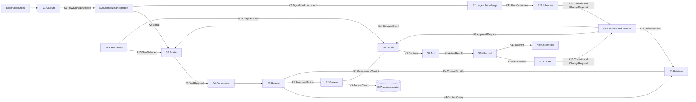

# Company Brain Core Pipeline: Requirements, Stages, Contracts and Acceptance Test

Version 1, 8 October 2026. Owner: Pamuditha, Finebase Labs. Source brief: `docs/CB_Frontend_Build_Brief_v2.md`.

This document covers the main data pipeline of the Company Brain. It leaves out logins, sign up, profile screens and other basic plumbing. It starts where a raw signal enters the brain. It ends where a governed outcome leaves it and feeds learning back in. Tables carry the content, and short paragraphs only connect them.

## 0. Scope in one table

| Item | Value |
|---|---|
| System name | Company Brain core pipeline |
| Starting input | A raw signal from a connected source. Examples are an inbound customer email, a chat message, a payment webhook, a Microsoft Clarity export, a calendar change or an uploaded document. |
| Final output | A governed outcome. The action runs in the outside world or waits for approval, template fields are filled, the trace and audit are written, and the run feeds the learning loop that can merge a new skill or policy version. |
| Tenant used in examples | Finebase Labs, currency LKR, timezone Asia/Colombo |
| Out of scope | Login, SSO, user management, billing of the brain itself, native mobile apps, filing with authorities |
| Backend base | `backend/` FastAPI project managed by uv |
| Frontend base | `frontend/` Next.js App Router project with TypeScript and Tailwind |

## 1. Requirements: every event, in order

The pipeline has four lanes. Lane A turns a signal into an action. Lane B turns documents into ground truth. Lane C turns finished runs into better skills and policies. Lane D watches deadlines and asks for missing information. The lanes share one event backbone, so each lane's output becomes another lane's input.

### 1.1 Lane A: signal to governed action

| # | Event | What happens | Actor |
|---|---|---|---|
| A01 | Signal emitted | A source system emits something new. Gmail pushes a new message, the payment gateway fires a webhook, or a user uploads a file. | External source |
| A02 | Signal received | The connector receives the signal. It verifies the webhook signature or the OAuth token. | Connector service |
| A03 | Grant checked | The connector confirms the tenant granted this source and scope. A signal from an ungranted scope is dropped and logged. | Connector service |
| A04 | Raw payload stored | The raw body is written once to object storage. Its SHA256 hash becomes the storage key, so repeats do not duplicate. | Connector service |
| A05 | Raw envelope published | A small envelope with a pointer to the raw body goes to Kafka topic `signals.raw`. The raw body never travels on Kafka. | Connector service |
| A06 | Signal normalized | The normalizer parses the raw body. It maps it to one canonical Signal shape with tenant, cluster, kind, actor, subject and time. | Normalizer |
| A07 | Personal data masked | Personal data is detected and swapped for vault tokens. Names, emails, phone numbers, NIC numbers and card fragments are covered. | Normalizer with PII vault |
| A08 | Duplicate check | A dedup key is checked in Redis. A duplicate stops here. | Normalizer |
| A09 | Normalized signal published | The masked Signal goes to `signals.normalized`. Document kinds also go on to Lane B. | Normalizer |
| A10 | Signal routed | The resolver matches the Signal to an activity, a skill version and an agent. It reads the resolver table from the production branch. | Resolver |
| A11 | Unrouted path | When nothing matches above the score floor, the Signal goes to `tasks.unrouted`. A human sees it in the escalations queue. | Resolver |
| A12 | Task created | A Task with a base criticality, a deadline and a priority is published to `tasks.created`. | Resolver |
| A13 | Workflow started | A durable task workflow starts in Temporal. Its workflow ID equals the task ID, so a retry cannot start it twice. | Orchestrator |
| A14 | Run opened | A Run row is created. The UI gets a live "run started" event. | Agent runtime |
| A15 | Context requested | The agent asks the context service for facts, policies, document chunks and skill steps. | Agent runtime |
| A16 | Access filtered retrieval | The context service runs hybrid search. It filters by the agent's capabilities intersected with the human it acts for. Facts are read as of now in both valid time and recorded time. | Context service |
| A17 | Retrieval checks logged | Every allowed and denied item produces an access decision record. Denied items are counted, never returned. | Access service |
| A18 | Model judgment | Claude plans the work and drafts a reply or a proposed action. Each item it relies on is cited. | Agent runtime |
| A19 | Action proposed | A ProposedAction names a tool, its typed arguments and what it touches: money, personal data, public content, legal or tax, and clusters. | Agent runtime |
| A20 | Access check at action time | The access service asks OPA whether this principal may run this tool on this resource now. It returns allow or deny with the rule and reason. | Access service |
| A21 | Policy evaluated | Deterministic policy rules run against the arguments. An example is "refund window is 30 days and the auto threshold is LKR 50,000". | Governance service |
| A22 | Quality gate run | Gates check grounding, citations, tone, personal data leakage and output schema. | Governance service |
| A23 | Criticality fixed | Final criticality comes from the activity default plus the policy result. | Governance service |
| A24 | Route decided | The verdict is one of four routes: execute, approval required, escalate or block. | Governance service |
| A25 | Approval requested | When approval is needed, an ApprovalRequest is published. The workflow sleeps on a timer with a deadline and an expiry. | Approval service |
| A26 | Human decision | A human approves, rejects, requests changes, delegates or takes over. C4 needs two distinct L1 humans. | Human in L1, L2 or L3 |
| A27 | Action executed | The tool adapter calls the outside system with an idempotency key. Examples are a refund call or a sent email. | Tool adapter |
| A28 | Action result recorded | The outcome, the external reference and any error are recorded. | Tool adapter |
| A29 | Template fields filled | Fields in the matching template are filled with value, source items and a fresh until time. | Template service |
| A30 | Run closed | The run is finalized. The full trace goes to object storage, and a RunRecord goes to `runs.completed`. | Recorder |
| A31 | Audit appended | An AuditEvent is appended to a hash chained log. | Audit service |
| A32 | UI updated | The SSE gateway pushes the change to every viewer allowed to see it. | SSE gateway |

### 1.2 Lane B: document to ground truth

| # | Event | What happens | Actor |
|---|---|---|---|
| B01 | Document arrives | A document Signal arrives through A01 to A09. Examples are an uploaded invoice, a contract or a pricing PDF. | Lanes A or D |
| B02 | Filing rule applied | Filing rules pick cluster, document type, sensitivity, retention and ACL labels. | Ingest service |
| B03 | Document filed | A Document row is created and `docs.filed` is published. | Ingest service |
| B04 | Text extracted | Docling parses layout, tables and scanned pages. | Ingest service |
| B05 | Chunks embedded | Text is chunked. Each chunk is embedded with Voyage AI and stored with its ACL labels and a full text index. | Ingest service |
| B06 | Fact candidates extracted | Claude Haiku extracts candidate facts. Each one carries a statement, subject, value, valid time and the exact evidence span. | Ingest service |
| B07 | Candidates published | Candidates go to `facts.candidates`. | Ingest service |
| B08 | Librarian compares | The librarian classifies each candidate as new, duplicate, conflict, stale or unverified. | Librarian |
| B09 | Dependents found | For a conflict, the librarian walks the graph. It lists every skill, policy, template and web page that depends on the old fact. | Librarian |
| B10 | Proposal drafted | The librarian proposes a winning source and a new validity interval. It bundles every dependent update into one draft commit. | Librarian |
| B11 | Change request opened | A C3 change request goes to Lane C step C06 for approval. | Version service |
| B12 | Fact committed | On merge, the fact is written to main. The old version gets its valid time closed. Nothing is overwritten. | Version service |

### 1.3 Lane C: learning and versioned change

| # | Event | What happens | Actor |
|---|---|---|---|
| C01 | Nightly review starts | At 02:00 Asia/Colombo the Quality Supervisor starts. It also starts when a human presses Skillify. | Temporal schedule or human |
| C02 | Runs read | The supervisor reads yesterday's RunRecords, escalations and denials. | Quality Supervisor |
| C03 | Failures classified | Each failure gets a class: wrong route, missing knowledge, stale policy, tool error, quality gate failure or access gap. | Quality Supervisor |
| C04 | Health and drift computed | Skill health and the five policy freshness signals are computed. These are task success, pass^k, conformance to observed runs and drift points. | Metrics service |
| C05 | Fix drafted | A fix is drafted as a commit on a new sandbox branch. Skillify drafts a new skill from a human takeover in the same way. | Quality Supervisor or Skillify |
| C06 | Change request opened | A change request is opened from the sandbox branch to main. | Version service |
| C07 | Sandbox tests run | The skill eval suite and trigger evals run in the sandbox. | Eval runner |
| C08 | Replay run | The candidate is replayed against recent recorded runs. Example output: "37 of the last 412 refund conversations get a different decision". | Replay service |
| C09 | Impact preview attached | The plain language diff, structured diff, test results and impact preview are attached. | Version service |
| C10 | Criticality fixed for the change | The change request gets its criticality. Touching money, personal data, public content, legal or tax, or more than one cluster moves it up one level. | Governance service |
| C11 | Auto apply or approval | C0 and C1 merge automatically and are logged. C2 and above wait for the matrix approver. C4 also waits for its cooling period. | Approval service |
| C12 | Optional shadow run | A staging shadow can run the candidate on live traffic without acting. | Orchestrator |
| C13 | Merged | The merge moves main to the new commit and can add a release tag. | Version service |
| C14 | Release published | `graph.released` is published. Caches are invalidated, the resolver reloads, and changed nodes are embedded again. | Version service |
| C15 | Digest built | The L1 morning digest lists runs, failures, fixes applied and changes waiting. | Digest job |

### 1.4 Lane D: readiness and evidence

| # | Event | What happens | Actor |
|---|---|---|---|
| D01 | Readiness tick | A Temporal schedule runs each hour per tenant. | Readiness scheduler |
| D02 | Gap computed | Required evidence for each obligation, template and loop is compared with what exists and is fresh. | Readiness scheduler |
| D03 | Gap published | Each gap becomes a GapDetected event with its due date and the chosen action. | Readiness scheduler |
| D04 | Gap action taken | One of three actions follows. An agent is dispatched through A12, the DRI gets an evidence request, or a source grant is requested. | Readiness scheduler |
| D05 | Escalation over time | Unanswered requests escalate on a schedule, for example 21, 14, 7 and 2 days before the deadline. | Approval service |
| D06 | Evidence arrives | An uploaded file or a newly granted source enters Lane A at A01 and Lane B at B01. | DRI or connector |
| D07 | Readiness recomputed | Readiness turns green once the required facts exist with provenance. | Readiness scheduler |

## 2. Design: stages and seams

The events above fall into fifteen stages. Each stage is one deployable process, or one worker type, with a single job. A seam sits between two stages, and every seam has a written contract. That way a stage can be rebuilt without breaking its neighbours.

### 2.1 Complete flow



### 2.2 Stage table

| Stage | Job | Process | Reads | Writes | Main tech |
|---|---|---|---|---|---|
| S1 Capture | Receive, verify and persist raw signals | `capture` FastAPI app for webhooks, plus poll workers | Connector grants, connector secrets | Object storage `raw/`, topic `signals.raw` | FastAPI, Kafka producer, S3 client |
| S2 Normalize and protect | Canonical shape, masking, dedup | `normalizer` Kafka consumer | `signals.raw`, raw objects | `signals.normalized`, PII vault | Python, Presidio, Redis |
| S3 Route | Match a signal to activity, skill and agent | `resolver` Kafka consumer | `signals.normalized`, resolver table on main, `graph.released`, `evidence.gaps` | `tasks.created`, `tasks.unrouted` | Python, Redis cache, Haiku for tie breaks |
| S4 Orchestrate | Durable task lifecycle, timers, retries | Temporal worker `task_workflow` | `tasks.created` | Temporal history, `runs` table | Temporal Python SDK |
| S5 Retrieve | Access filtered, bitemporal hybrid retrieval | `context` internal FastAPI | Postgres graph, facts, chunks | `access.decisions` | pgvector, Postgres full text, Voyage rerank |
| S6 Reason | Plan, draft, propose actions | Temporal activities `agent_step` | ContextBundle, skill steps | `runs.steps` | Anthropic Messages API with tool use |
| S7 Govern | Access check, policy rules, quality gates, criticality | `governance` internal FastAPI | ProposedAction, policies on main | `access.decisions`, verdict on the run | OPA, Python rule engine, Haiku graders |
| S8 Decide | Approvals, escalations, takeover, delegation, expiry | `approvals` service and Temporal `approval_workflow` | Verdicts, change requests, gaps | `approvals.requested`, `approvals.decided`, `approvals` table | FastAPI, Temporal timers |
| S9 Act | Call outside systems safely | Temporal activities `tool_call` | Decision with final arguments | `actions.executed`, `actions` table | Typed tool adapters, Redis idempotency |
| S10 Record | Templates, trace, audit, live UI | `recorder` consumer and `sse` gateway | `runs.steps`, `actions.executed` | `runs.completed`, `audit.events`, `ui.events`, Postgres, `traces/` objects | Python, SSE |
| S11 Ingest knowledge | File, parse, chunk, embed, extract | `ingest` consumer | Document signals | `docs.filed`, `docs.extracted`, `facts.candidates`, chunks | Docling, Voyage embeddings, Haiku |
| S12 Librarian | Compare candidates with ground truth | `librarian` consumer | `facts.candidates`, facts, graph | Draft commits, `graph.commits` | Python, Opus for conflict reasoning |
| S13 Learn | Nightly review, health, drift, Skillify, evals, replay | Temporal `nightly_review` and `change_request_workflow` | `runs.completed`, run traces | Draft commits, eval results, replay results | Opus, Sonnet, Temporal |
| S14 Version and release | Git for the graph | `graph` service | Commits, approvals | `graph.commits`, `graph.released`, graph tables | Postgres, transactional outbox |
| S15 Readiness | Find missing evidence early | Temporal schedule `readiness` | Obligations, templates, facts | `evidence.gaps` | Temporal schedules |

## 3. Design: technology choices

Each layer has one main choice. The table says why it was picked and how it runs locally and in production. Fewer moving parts won wherever two options were close. That is why Postgres holds both the graph and the vectors.

| Layer | Choice | Why | Local dev | Production |
|---|---|---|---|---|
| Console UI | Next.js App Router, TypeScript, Tailwind, shadcn/ui, TanStack Query | Matches the frontend brief | `frontend/` on port 3000 | Vercel or a container |
| Public API | FastAPI with Pydantic v2 | Typed contracts, OpenAPI for the zod client | `backend/` on port 8000 | Containers on AWS ECS |
| Background services | Python processes in the same uv project | One codebase, many entry points | `uv run` per process | One ECS service per process |
| Event backbone | Kafka protocol. Redpanda locally, Kafka in production. | Ordered per key, replayable, decouples stages | Redpanda single node | Amazon MSK or Confluent Cloud |
| Schema registry | JSON Schema generated from Pydantic, kept in a registry | Producers cannot publish a shape consumers do not know | Redpanda built in registry | Confluent Schema Registry or Apicurio |
| Durable workflows | Temporal | Long waits for approvals, timers, expiry, retries and exactly once workflow starts | Temporal CLI dev server | Temporal Cloud or self hosted |
| System of record | PostgreSQL 17 with row level security per tenant | Relational state, bitemporal ranges, transactions with the outbox | Docker | Amazon RDS or Aurora PostgreSQL |
| Vector store | pgvector with HNSW indexes inside the same Postgres | Vectors sit beside ACL labels and RLS, so filtering happens in one query | Same Postgres | Same. Move to Qdrant only past tens of millions of chunks. |
| Keyword search | Postgres full text search | Hybrid retrieval without another cluster | Same Postgres | Same |
| Knowledge graph | Versioned node and edge tables in Postgres | Git style commits and branches need transactions. 2,000 to tens of thousands of nodes fit easily. | Same Postgres | Same. Add a Neo4j read projection only if traversal gets slow. |
| Cache | Redis compatible store (Valkey) | Idempotency keys, resolver cache, short access decision cache, rate limits | Docker | Amazon ElastiCache |
| Object storage | S3 API. MinIO locally. | Raw signals, documents, evidence, traces, replay sets | MinIO | Amazon S3 with KMS encryption |
| Access decisions | Open Policy Agent with Rego | Role and attribute rules evaluated at action time, with logged decisions | OPA container | OPA sidecar per service |
| LLM | Anthropic Claude | Agents, extraction, graders, drafting | API | API |
| Embeddings and rerank | Voyage AI | Anthropic does not offer embeddings, and Voyage is its recommended partner | API | API |
| Document parsing | Docling | Local, no key, handles tables and scans | Python library | Same, in the ingest worker |
| PII detection | Microsoft Presidio plus custom recognizers | Sri Lankan NIC, local phone formats, LKR card fragments | Python library | Same |
| Secrets | `.env` locally. AWS Secrets Manager and KMS in production. | Tenant connector tokens are envelope encrypted | `.env` not committed | Secrets Manager plus KMS |
| Observability | OpenTelemetry to Grafana (Tempo, Loki, Prometheus), plus Sentry | One trace ID from webhook to UI | Grafana container optional | Grafana Cloud plus Sentry |
| Live updates | Server Sent Events from FastAPI | One way push is enough, and it is simple behind proxies | Port 8000 `/api/stream` | Same, behind the load balancer |

### 3.1 Model use per stage

Different steps need different depth. Cheap fast models do the high volume work, and the strongest model handles the rare hard calls.

| Stage | Task | Model | Why |
|---|---|---|---|
| S3 Route | Tie break when two resolver rules score close | Claude Haiku 5.5 | High volume, short output |
| S6 Reason | Worker agent judgment and drafting | Claude Sonnet 5.5 | Strong tool use at good cost |
| S7 Govern | Quality gate grading for tone and grounding | Claude Haiku 5.5 | Fast pass or fail |
| S11 Ingest | Fact candidate extraction | Claude Haiku 5.5 | Many documents, structured output |
| S12 Librarian | Conflict reasoning and proposals | Claude Opus 5.5 | Rare, high stakes |
| S13 Learn | Failure classification, fix and skill drafting | Claude Opus 5.5 | Quality of drafts decides approval load |

Model IDs live in config (`MODEL_WORKER`, `MODEL_SUPERVISOR`, `MODEL_FAST`), so upgrades stay a config change. Prompt caching is used for skill steps and policies, because they repeat on every run.

## 4. Design: storage map

Every byte has one home. Postgres is the system of record. Kafka carries events for a limited time. Redis only holds things that can be rebuilt. Object storage holds large or raw content.

### 4.1 Stores

| Store | Technology | Holds | Written by | Read by | Retention |
|---|---|---|---|---|---|
| Relational core | PostgreSQL | Tenants, clusters, agents, tasks, runs, approvals, change requests, templates, obligations | Most stages | API, all stages | Life of tenant |
| Graph | PostgreSQL tables `graph_commits`, `graph_branches`, `graph_nodes`, `graph_edges` | Skills, policies, access rules, sensors, templates, agents and tools, all versioned | S14 only | S3, S5, S7, UI | Forever, append only |
| Ground truth | PostgreSQL `facts` with `valid_time` and `recorded_time` ranges | Bitemporal facts with evidence and dependents | S14 on merge | S5, S12, S15 | Forever, closed but never deleted, except C4 deletion |
| Vector and text index | pgvector plus `tsvector` in `chunks` | Chunk embeddings, ACL labels, sensitivity | S11, S14 | S5 | Follows document retention |
| PII vault | Separate Postgres schema with encrypted columns and its own role | Token to real value map | S2 | Reveal API only, audited | Follows the data request register |
| Access decision log | PostgreSQL `access_decisions`, partitioned by month | Every allow and deny | Consumer of `access.decisions` | Security screen, Sentinel, research console | 400 days |
| Audit log | PostgreSQL `audit_events`, append only, hash chained, partitioned | Every consequential event | Consumer of `audit.events` | Audit trail screen | 7 years (sample value, confirm) |
| Outbox | PostgreSQL `outbox` | Events written in the same transaction as state | S8, S14, S10 | Outbox relay to Kafka | Deleted after publish |
| Event backbone | Kafka topics (section 4.2) | Events in motion | All stages | All stages | 1 to 30 days |
| Cache | Valkey | Idempotency keys, resolver table per commit, access decision cache, rate limits, presence | S1, S2, S3, S7, S9 | Same | Minutes to 7 days |
| Objects | S3 bucket `brain` with prefix `{tenant}/raw/`, `documents/`, `evidence/`, `traces/`, `replays/` | Raw bodies, files, full traces, replay sets | S1, S11, S10, S13 | S2, S11, UI, S13 | Raw 90 days, others by filing rule |
| Workflow state | Temporal persistence | Workflow history and timers | S4, S8, S13, S15 | Temporal | 30 days after close |

### 4.2 Kafka topics

Every topic key starts with the tenant ID, so one tenant's events keep their order and never mix with another's. Every consumer is idempotent on `event_id`. Each consumer group also has its own dead letter topic named `{topic}.dlq`.

| Topic | Key | Partitions (prod) | Retention | Producer | Consumers |
|---|---|---|---|---|---|
| `signals.raw` | tenant:source:external_id | 12 | 7 days | S1 | S2 |
| `signals.normalized` | tenant:subject_ref | 12 | 7 days | S2 | S3, S11, UX aggregator |
| `tasks.created` | tenant:task_id | 12 | 7 days | S3, S15 | S4 starter |
| `tasks.unrouted` | tenant | 3 | 14 days | S3 | Escalations, S13 |
| `runs.steps` | tenant:run_id | 24 | 3 days | S6, S7, S9 | S10, SSE gateway |
| `runs.completed` | tenant:run_id | 12 | 30 days | S10 | S13, metrics, template board |
| `access.decisions` | tenant:principal | 12 | 30 days | S5, S7 | Decision log writer, Security Sentinel, research console |
| `approvals.requested` | tenant:approval_id | 6 | 30 days | S8 (outbox) | Notifications, SSE gateway |
| `approvals.decided` | tenant:approval_id | 6 | 30 days | S8 (outbox) | S4 signal handler, S14 |
| `actions.executed` | tenant:action_id | 6 | 30 days | S9 | S10 |
| `docs.filed` | tenant:document_id | 6 | 7 days | S11 | S11 extractor |
| `docs.extracted` | tenant:document_id | 6 | 7 days | S11 | Library screen |
| `facts.candidates` | tenant:subject_ref | 6 | 14 days | S11 | S12 |
| `graph.commits` | tenant:branch | 6 | 30 days | S14 (outbox) | S13, UI versioning |
| `graph.released` | tenant | 3 | Compacted | S14 (outbox) | S3, S5, S6, S11 |
| `evidence.gaps` | tenant:obligation_id | 3 | 30 days | S15 | S3, S8 |
| `audit.events` | tenant | 12 | 30 days | All stages | Audit writer |
| `ui.events` | tenant | 6 | 1 day | S10 | SSE gateway |

## 5. Design: contracts per seam

The contracts below are the source of truth. Pydantic models in `backend/app/contracts/` define them. JSON Schema is generated from those models and registered. The frontend zod schemas are generated from the same OpenAPI document. So one change in Python flows to every consumer.

### 5.0 Shared envelope for every Kafka message

| Field | Type | Required | Notes |
|---|---|---|---|
| `event_id` | UUIDv7 | yes | Time ordered. Consumers dedupe on it. |
| `event_type` | string | yes | For example `signal.normalized` |
| `schema_version` | int | yes | Bump on any breaking change. Consumers accept N and N minus 1. |
| `tenant_id` | string | yes | Never inferred later |
| `cluster_id` | string | yes | `finebase_platform`, `finance_compliance` and so on |
| `env` | enum `production`, `staging`, `sandbox` | yes | Sandbox events never reach real tools |
| `branch` | string | yes | `main` for production |
| `occurred_at` | timestamp UTC | yes | When it happened in the world |
| `recorded_at` | timestamp UTC | yes | When the brain learned it |
| `trace_id` | W3C trace ID | yes | One ID from webhook to UI |
| `correlation_id` | string | yes | Usually the task ID |
| `causation_id` | UUIDv7 | no | The event that caused this one |
| `producer` | string | yes | Stage and version, for example `normalizer@1.4.0` |
| `payload` | object | yes | One of the contracts below |

### 5.1 Shared types

| Type | Shape | Notes |
|---|---|---|
| `VersionRef` | `{ id, version: int, branch, commit_id }` | Every skill, policy and template reference uses it |
| `Money` | `{ amount_minor: int, currency: ISO 4217 }` | LKR 85,000.00 is `8500000` with `LKR`. Never use floats. |
| `Principal` | `{ type: agent or human, id, capabilities: string[], tier }` | Capabilities come from grants on main |
| `Criticality` | int 0 to 4 | C0 to C4 from the brief |
| `PiiToken` | string `pii_tok_` plus 22 characters | Never reversible without the vault |
| `Touches` | `{ money: bool, personal_data: bool, public_content: bool, legal_tax: bool, clusters: string[] }` | Drives criticality |

### 5.2 Seam contracts

#### K1 RawSignalEnvelope (S1 to S2)

Transport: Kafka `signals.raw`. Delivery: at least once. Dedupe on `raw_sha256` plus `external_id`.

| Field | Type | Required | Notes |
|---|---|---|---|
| `connector_id` | string | yes | Which connector instance |
| `grant_id` | string | yes | The tenant grant that allowed capture |
| `source_type` | enum `email`, `chat`, `webhook`, `poll`, `upload`, `clarity_export`, `calendar` | yes | |
| `external_id` | string | yes | Gmail message ID, gateway event ID and so on |
| `received_at` | timestamp | yes | |
| `signature_verified` | bool | yes | Must be true. Otherwise it is dropped before publish. |
| `raw_object_uri` | string | yes | `s3://brain/{tenant}/raw/{sha256}` |
| `raw_sha256` | string | yes | |
| `content_type` | string | yes | |
| `size_bytes` | int | yes | Over 25 MB goes to the upload path |
| `headers_subset` | map | no | Only allowlisted headers |

#### K2 Signal (S2 to S3 and S11)

Transport: Kafka `signals.normalized`. Ordering: per `subject_ref`, so one customer's messages stay in order.

| Field | Type | Required | Notes |
|---|---|---|---|
| `signal_id` | string | yes | |
| `raw_event_id` | UUIDv7 | yes | Link back to K1 |
| `kind` | enum `customer_message`, `billing_event`, `document_arrived`, `usage_event`, `calendar_event`, `ux_signal`, `monitor_alert`, `review` | yes | |
| `channel` | string | yes | `email`, `chat`, `stripe`, `clarity` and so on |
| `actor` | `{ type: customer, human or system, ref: PiiToken or id }` | yes | |
| `subject` | `{ entity_type, entity_ref }` | yes | For example a subscription or an invoice |
| `text_masked` | string | no | Personal data replaced by tokens |
| `language` | BCP 47 | no | |
| `entities` | `[{ type, value_or_token, confidence }]` | no | Amounts, dates, order IDs |
| `attachments` | `[{ object_uri, mime, sha256 }]` | no | Each becomes a document signal too |
| `pii_tokens` | `PiiToken[]` | yes | Empty if none |
| `sensitivity` | enum `public`, `internal`, `confidential`, `restricted` | yes | |
| `dedup_key` | string | yes | |

#### K3 TaskRequest (S3 to S4)

Transport: Kafka `tasks.created`. The Temporal workflow ID equals `task_id`.

| Field | Type | Required | Notes |
|---|---|---|---|
| `task_id` | string | yes | |
| `signal_ids` | string[] | yes | One or more signals |
| `activity_id` | string | yes | From the activity catalog |
| `skill_ref` | VersionRef | yes | Pinned at route time, so a mid run release does not change it |
| `agent_id` | string | yes | |
| `on_behalf_of` | human ID or null | yes | Caps what the agent may do |
| `resolver_rule_id` | string | yes | |
| `match_score` | float 0 to 1 | yes | Floor is 0.72 (sample, tune per tenant) |
| `base_criticality` | Criticality | yes | Activity default |
| `due_at` | timestamp | yes | SLA from the activity |
| `priority` | int 1 to 5 | yes | |

#### K4 ContextQuery and ContextBundle (S6 to S5 and back)

Transport: synchronous internal HTTP `POST /internal/context/query`. Timeout is 2 seconds.

| ContextQuery field | Type | Required | Notes |
|---|---|---|---|
| `run_id` | string | yes | |
| `principal` | Principal | yes | |
| `on_behalf_of` | human ID or null | yes | Effective rights are the intersection |
| `query_text` | string | yes | |
| `entity_refs` | string[] | no | Boosts exact entity matches |
| `as_of_valid` | timestamp | no | Default now |
| `as_of_recorded` | timestamp | no | Default now |
| `branch` | string | yes | `main`, or a sandbox branch in replays |
| `node_types` | enum[] `fact`, `policy`, `chunk`, `skill_step` | no | |
| `top_k` | int | no | Default 12 |
| `max_tokens` | int | no | Default 6,000 |

| ContextBundle field | Type | Notes |
|---|---|---|
| `items[]` | `{ item_id, kind, text, source { document_id, uri, page, span }, valid_from, valid_to, recorded_at, verified_by, version_ref, score, sensitivity }` | Only allowed items |
| `denied_count` | int | Denied items are never returned |
| `denied_reasons` | `[{ rule_id, count }]` | Shown in the trace as locked items |
| `access_decision_ids` | string[] | Links to the decision log |
| `latency_ms` | int | |

#### K5 ProposedAction (S6 to S7)

Transport: Temporal activity input. It is also persisted as a `runs.steps` event.

| Field | Type | Required | Notes |
|---|---|---|---|
| `run_id`, `step_id` | string | yes | |
| `action_type` | enum `reply_customer`, `issue_refund`, `apply_credit`, `update_cms`, `schedule_meeting`, `fill_template`, `request_evidence`, `escalate` | yes | |
| `tool_id`, `tool_version` | string, int | yes | |
| `arguments` | object, typed per tool | yes | A refund is `{ payment_ref, amount: Money, reason_code }` |
| `money` | Money or null | yes | |
| `touches` | Touches | yes | |
| `rationale_summary` | string | yes | Shown to humans, max 600 characters |
| `citations` | item_id[] | yes | At least one for factual claims |
| `model` | `{ provider, model_id, input_tokens, output_tokens }` | yes | |
| `confidence` | float 0 to 1 | yes | |

#### K6 AccessCheck (S5 and S7 to the access service)

Transport: synchronous internal HTTP to OPA. Budget is 10 ms at p95. Allow results are cached for 60 seconds per principal, resource and graph commit.

| Request field | Type | Notes |
|---|---|---|
| `principal` | Principal | |
| `on_behalf_of` | human ID or null | |
| `action` | string | For example `tool:issue_refund` or `read:fact` |
| `resource` | `{ type, id, sensitivity, cluster, version_ref }` | |
| `context` | `{ env, money, time, channel }` | |

| Response field | Type | Notes |
|---|---|---|
| `decision_id` | string | |
| `decision` | enum `allow`, `deny` | |
| `rule_id` | string | The deciding rule |
| `reason` | string | Plain language, shown in "view as" |
| `obligations` | string[] | For example `mask_pii` |
| `latency_ms` | int | |

#### K7 GovernanceVerdict (S7 to S8)

Transport: Temporal activity output. It is also a `runs.steps` event.

| Field | Type | Notes |
|---|---|---|
| `run_id`, `step_id` | string | |
| `access_decision_id` | string | |
| `policy_results[]` | `{ policy_ref: VersionRef, passed: bool, rule_id, explanation }` | |
| `quality_gates[]` | `{ gate_id, passed: bool, detail }` | |
| `criticality` | Criticality | Final value |
| `criticality_reasons` | string[] | For example `outside_refund_window`, `above_auto_threshold` |
| `route` | enum `execute`, `approval_required`, `escalate`, `block` | Deny always means `block` |
| `required_approvers` | `{ tier, count, roles[] }` | From the criticality matrix |
| `cooling_period_hours` | int | C4 only |

#### K8 ApprovalRequest and Decision (S7 or S14 to S8, then S8 to S9 or S14)

Transport: Kafka `approvals.requested` and `approvals.decided` through the outbox. A Temporal signal wakes the waiting workflow.

| ApprovalRequest field | Type | Notes |
|---|---|---|
| `approval_id` | string | |
| `subject` | `{ kind: action, change_request, grant or evidence; ref }` | |
| `criticality` | Criticality | |
| `summary_plain` | string | For example "Refund LKR 85,000 to an annual plan bought 41 days ago" |
| `diff_ref`, `impact_preview_ref` | string or null | For change requests |
| `evidence_refs` | string[] | |
| `required_approvers` | `{ tier, count, roles[] }` | |
| `dri_id` | human ID | Exactly one |
| `due_at`, `expires_at` | timestamp | Expiry produces `expired`, never a silent skip |

| Decision field | Type | Notes |
|---|---|---|
| `approval_id` | string | |
| `decision` | enum `approve`, `reject`, `request_changes`, `delegate`, `takeover`, `expired` | |
| `decided_by` | human ID[] | C4 needs two distinct L1 IDs |
| `decided_at` | timestamp | |
| `comment` | string | |
| `delegated_to` | human ID or null | |
| `final_arguments` | object or null | When a human edited the action |

#### K9 ActionResult (S9 to S10)

Transport: Kafka `actions.executed`.

| Field | Type | Notes |
|---|---|---|
| `action_id`, `run_id` | string | |
| `tool_id` | string | |
| `idempotency_key` | string | `{tenant}:{run_id}:{step_id}`. It is also sent to the outside API. |
| `status` | enum `succeeded`, `failed`, `retrying`, `compensated` | |
| `external_ref` | string or null | For example the gateway refund ID |
| `request_hash` | string | Proves what was sent |
| `response_summary` | string | No personal data |
| `attempted_at`, `completed_at` | timestamp | |
| `error` | `{ code, retryable: bool }` or null | |

#### K10 RunRecord (S10 to S13)

Transport: Kafka `runs.completed`. The full trace lives at `trace_object_uri`.

| Field | Type | Notes |
|---|---|---|
| `run_id`, `task_id`, `agent_id` | string | |
| `skill_ref` | VersionRef | |
| `outcome` | enum `resolved`, `escalated`, `failed`, `blocked`, `abandoned` | |
| `steps[]` | `{ step_id, kind: judgment, tool, retrieval, access_check, quality_gate or human; started_at, duration_ms, decision, reason, refs[] }` | Summary only |
| `template_fills[]` | `{ template_ref, field, value_ref, source_item_ids[], filled_at, fresh_until }` | |
| `human_touch` | bool | True when any human acted |
| `cost` | `{ input_tokens, output_tokens, usd_micro }` | |
| `latency_ms` | int | |
| `trace_object_uri` | string | |

#### K11 UiEvent (S10 to the Next.js console)

Transport: SSE on `GET /api/stream`. The gateway filters each event by the viewer's permissions before sending it.

| Field | Type | Notes |
|---|---|---|
| `type` | enum `run.updated`, `agent.status`, `approval.created`, `approval.decided`, `template.updated`, `cr.updated`, `gap.created` | |
| `id` | string | Entity ID |
| `tenant_id`, `cluster_id`, `env` | string | |
| `display` | object | Only display fields. Personal data stays masked. |
| `at` | timestamp | |

#### K12 FactCandidate (S11 to S12)

Transport: Kafka `facts.candidates`.

| Field | Type | Notes |
|---|---|---|
| `candidate_id` | string | |
| `statement` | string | For example "Refund window for annual plans is 14 days" |
| `subject` | `{ entity_type, entity_ref }` | |
| `predicate` | string | |
| `value` | `{ type, raw, normalized }` | |
| `valid_from`, `valid_to` | timestamp or null | As stated in the source |
| `evidence` | `{ document_id, page, span, quote_sha256 }` | Exact location |
| `extractor` | `{ model_id, confidence }` | |
| `sensitivity` | enum | |

#### K13 Commit and ChangeRequest (S12, S13 and Skillify to S14)

Transport: graph service API, then `graph.commits` through the outbox.

| Commit field | Type | Notes |
|---|---|---|
| `commit_id` | string | Content hash |
| `parent_ids` | string[] | Two parents on merge |
| `branch` | string | For example `sandbox/skillify_refund_late_annual` |
| `author` | `{ type: human or agent, id }` | |
| `message` | string | |
| `changes[]` | `{ op: create, update or delete; node_type; node_id; before_hash; after }` | |
| `criticality` | Criticality | |
| `evidence_refs` | string[] | |

| ChangeRequest field | Type | Notes |
|---|---|---|
| `cr_id` | string | |
| `from_branch`, `to_branch` | string | |
| `commits` | commit_id[] | |
| `plain_diff` | string | "Refund window changes from 30 to 14 days, valid from 1 November" |
| `structured_diff_ref` | string | |
| `tests` | `{ suite_ref, passed, failed, pass_k: { k, rate } }` | |
| `impact_preview` | `{ runs_replayed, decisions_changed, sample_run_ids[], predicted_risk }` | |
| `approval_ids` | string[] | |
| `status` | enum `draft`, `testing`, `awaiting_approval`, `approved`, `merged`, `rejected`, `expired` | |

#### K14 ReleaseEvent (S14 to S3, S5, S6 and S11)

Transport: Kafka `graph.released`, compacted per tenant.

| Field | Type | Notes |
|---|---|---|
| `branch` | string | `main` |
| `commit_id` | string | |
| `tag` | string or null | |
| `changed_nodes[]` | `{ node_type, node_id, from_version, to_version }` | Consumers reload only these |
| `released_at` | timestamp | |

#### K15 GapDetected (S15 to S3 and S8)

Transport: Kafka `evidence.gaps`.

| Field | Type | Notes |
|---|---|---|
| `gap_id` | string | |
| `target` | `{ kind: obligation, template or loop; id }` | |
| `required_item` | string | For example "VAT return input invoices for September" |
| `due_at`, `prepare_by` | timestamp | |
| `action` | enum `dispatch_agent`, `request_dri`, `request_grant` | |
| `dri_id` | human ID | |
| `escalation_days` | int[] | Default `[21, 14, 7, 2]`, sample value |
| `is_sample` | bool | True for all seed obligations |

## 6. Design: failure handling per seam

A pipeline is only as good as its worst seam. Each seam below has a defined failure behaviour, so nothing fails silently.

| Seam | Failure | Behaviour |
|---|---|---|
| K1 | Bad signature | Reject with 401. Nothing is stored. Alert after 10 in 5 minutes. |
| K1 | Kafka unavailable | Webhook returns 503 so the source retries. Poll workers keep a local cursor. |
| K2 | Parse error | Message goes to `signals.raw.dlq` with the error. Shown in Sensors health. |
| K3 | No route above floor | `tasks.unrouted`, then escalations queue, then counted in the nightly review |
| K4 | Retrieval timeout | One retry. Then the run escalates with reason `context_unavailable`. |
| K5 | Model error or invalid tool arguments | Two retries with schema feedback. Then escalate. |
| K6 | OPA unreachable | Fail closed. Deny with reason `access_service_unavailable`. |
| K7 | Quality gate fails | Back to S6 once with the gate feedback. Then escalate. |
| K8 | Approval expires | Decision becomes `expired`. The workflow escalates to the DRI's delegate, never auto approves. |
| K9 | Tool fails, retryable | Temporal retry with backoff up to 6 attempts, using the same idempotency key |
| K9 | Tool fails, not retryable | Run is `failed`, the human is notified, and a compensation step runs if defined |
| K10 | Recorder down | Kafka retains events and the recorder catches up. The UI shows "delayed". |
| K12 | Extraction low confidence | Candidate is marked `unverified` and goes to the librarian queue |
| K13 | Merge conflict on a node | The change request is blocked and the conflict view opens for a human |
| K14 | Consumer misses a release | The compacted topic plus a commit check on every run makes it reload |

## 7. Design: quality targets

These targets keep a chat reply inside ten seconds while governance still runs on every step.

| Stage | Target at p95 |
|---|---|
| S1 to S2 capture plus normalize | 800 ms |
| S3 route | 150 ms |
| S5 retrieve | 400 ms |
| S6 one judgment step | 6 s |
| S7 govern, including access check | 200 ms, with access check 10 ms |
| S9 act, email or refund call | 1.5 s |
| S10 to UI event | 300 ms |
| End to end C0 chat reply | 10 s |
| Nightly review for 10,000 runs | Under 45 minutes |

## 8. API keys and secrets

Some keys are needed from day one, and others only when a cluster loop is switched on. Tenant connector tokens are never in `.env`. They are stored per tenant, envelope encrypted, after a grant is approved in the product. The browser never holds a secret.

### 8.1 Third party keys

| Variable | Service | Used by | Needed | How to get it |
|---|---|---|---|---|
| `ANTHROPIC_API_KEY` | Anthropic Claude | S3, S6, S7, S11, S12, S13 | Day one | console.anthropic.com |
| `VOYAGE_API_KEY` | Voyage AI embeddings and rerank | S5, S11, S14 | Day one | dash.voyageai.com |
| `GOOGLE_OAUTH_CLIENT_ID`, `GOOGLE_OAUTH_CLIENT_SECRET` | Gmail and Google Calendar connectors | S1, S9 | Day one for care and refunds | Google Cloud console, OAuth client |
| `GOOGLE_CLOUD_PROJECT_ID`, `GOOGLE_PUBSUB_TOPIC`, `GOOGLE_PUBSUB_SERVICE_ACCOUNT_JSON` | Gmail push notifications through Pub/Sub | S1 | Day one | Google Cloud console |
| `STRIPE_SECRET_KEY`, `STRIPE_WEBHOOK_SECRET` | Stripe, if Finebase bills through it | S1, S9 | Day one for billing and refunds | Stripe dashboard. Use test mode keys locally. |
| `PAYHERE_MERCHANT_ID`, `PAYHERE_MERCHANT_SECRET`, `PAYHERE_APP_ID`, `PAYHERE_APP_SECRET` | PayHere, if Finebase bills through it in Sri Lanka | S1, S9 | Day one, as an alternative to Stripe | PayHere merchant portal. Sandbox account locally. |
| `CLARITY_API_TOKEN` | Microsoft Clarity Data Export API | S1 poll worker | Website loop | Clarity project settings. It has a low daily request limit, so poll once a day. |
| `HUBSPOT_PRIVATE_APP_TOKEN` | HubSpot CRM | S1, S9 | Sales and onboarding loops | HubSpot private app |
| `CMS_API_TOKEN` | The website CMS (to confirm) | S9 | Web content loop | CMS settings |
| `GITHUB_APP_ID`, `GITHUB_APP_PRIVATE_KEY` | GitHub repository activity | S1 | Delivery loop | GitHub app settings |
| `BETTERSTACK_API_TOKEN` | Uptime monitor | S1 | Incident loop | Better Stack settings |
| `SENTRY_DSN` | Error reporting | All | Day one | sentry.io project |

### 8.2 Infrastructure secrets

| Variable | Purpose | Local value source | Production source |
|---|---|---|---|
| `DATABASE_URL` | Postgres with pgvector | Docker compose | Secrets Manager |
| `REDIS_URL` | Valkey | Docker compose | Secrets Manager |
| `KAFKA_BOOTSTRAP_SERVERS` | Kafka brokers | Redpanda | MSK or Confluent |
| `KAFKA_SASL_USERNAME`, `KAFKA_SASL_PASSWORD` | Kafka auth | Not used locally | Secrets Manager |
| `SCHEMA_REGISTRY_URL` | Schema registry | Redpanda | Registry endpoint |
| `S3_ENDPOINT`, `S3_ACCESS_KEY_ID`, `S3_SECRET_ACCESS_KEY`, `S3_BUCKET` | Object storage | MinIO | IAM role, no static keys |
| `TEMPORAL_ADDRESS`, `TEMPORAL_NAMESPACE`, `TEMPORAL_API_KEY` | Workflows | Dev server, no key | Temporal Cloud |
| `OPA_URL` | Access decisions | OPA container | Sidecar on localhost |
| `KMS_KEY_ID` | Envelope encryption of tenant tokens and the PII vault | Local test key in `.env` | AWS KMS |
| `INTERNAL_SERVICE_TOKEN` | Service to service auth | Random value | Replaced by mTLS |
| `MODEL_WORKER`, `MODEL_SUPERVISOR`, `MODEL_FAST`, `EMBEDDING_MODEL` | Model selection | `.env` | Parameter Store |
| `NEXT_PUBLIC_API_BASE_URL` | Frontend API base, the only frontend variable | `http://localhost:8000` | Public API URL |

## 9. Local development environment

The whole pipeline runs on one laptop. Docker Compose holds the infrastructure, and uv runs each Python process.

| Service | Port | Role |
|---|---|---|
| Next.js console (`frontend/`) | 3000 | UI |
| FastAPI public API and SSE (`backend/`) | 8000 | API, `/api/stream` |
| Capture webhooks | 8001 | S1 |
| Context and governance internal API | 8002 | S5, S7 |
| PostgreSQL 17 with pgvector | 5432 | System of record, vectors, graph |
| Valkey | 6379 | Cache |
| Redpanda | 9092 | Kafka API |
| Redpanda schema registry | 8081 | Schemas |
| Redpanda console | 8080 | Topic browser |
| MinIO | 9000, console 9001 | Object storage |
| Temporal dev server | 7233, UI 8233 | Workflows |
| OPA | 8181 | Access decisions |

| Python process | Entry | Stages |
|---|---|---|
| `api` | `uv run fastapi dev app/main.py` | Public API, SSE gateway |
| `capture` | `uv run python -m app.capture` | S1 |
| `normalizer` | `uv run python -m app.normalize` | S2 |
| `resolver` | `uv run python -m app.route` | S3 |
| `worker` | `uv run python -m app.workflows.worker` | S4, S6, S8 timers, S9, S13, S15 |
| `internal` | `uv run python -m app.internal` | S5, S7 |
| `recorder` | `uv run python -m app.record` | S10 |
| `ingest` | `uv run python -m app.ingest` | S11 |
| `librarian` | `uv run python -m app.librarian` | S12 |
| `graph` | `uv run python -m app.graph` | S14 and the outbox relay |

## 10. Contract to screen map

The frontend brief asks for screens that read through typed contracts. This map shows which contract feeds which screen. Mocks can then copy the exact shapes.

| Contract | Screens |
|---|---|
| K2 Signal | L2 Sensors and connections, L3 Live conversations |
| K3 TaskRequest | L3 Fleet view queue depth, L2 Resolver |
| K4 ContextBundle | L3 Run trace viewer retrieval steps, L1 Ask the Brain citations |
| K6 AccessCheck | L2 Security decision log, L2 Graph explorer "view as" |
| K7 GovernanceVerdict | L3 Run trace viewer gates, L3 Escalations queue |
| K8 ApprovalRequest, Decision | L1 Approvals inbox, notifications |
| K9 ActionResult | L3 Run trace viewer tool steps |
| K10 RunRecord | L3 Template board, L1 Progress, research console |
| K11 UiEvent | Every live list |
| K12 FactCandidate | L2 Library, L2 Librarian queue |
| K13 Commit, ChangeRequest | L2 Versioning, L1 Approvals inbox, L1 Morning digest |
| K14 ReleaseEvent | L2 Versioning history, audit trail |
| K15 GapDetected | L1 Entity protection, L1 Evidence requests, L2 Readiness scheduler |

## 11. Design: end to end acceptance test

One scenario exercises all four lanes of the main loop. A refund outside policy enters as an email. It ends as a merged skill that handles the next similar email without an escalation. Every check observes the system at its boundary. That means the outside sandboxes, the public API, the SSE stream and the Kafka topics, never internal function calls.

### 11.1 Fixed setup

| Item | Value |
|---|---|
| Tenant | Finebase Labs, LKR, Asia/Colombo |
| Policy on main | `refund_policy` v3: window 30 days, auto threshold LKR 50,000 (sample) |
| Skill on main | `refund_standard` v4, Refund Agent, autonomy supervised |
| DRI | Head of Customer Success, L1 |
| Operator | Customer care operator, L3 |
| Customer | Annual plan, LKR 85,000, bought 41 days ago |
| Gmail | Test mailbox with Pub/Sub push to the capture service |
| Payment gateway | Sandbox mode with test keys |
| Clock | Frozen test clock |

### 11.2 Scenario

```gherkin
Feature: Refund outside policy becomes a governed skill

  Scenario: A late annual refund escalates, is approved, skillified, merged, and the next one routes to the new skill
    Given tenant "Finebase Labs" has policy "refund_policy" version 3 on main with a 30 day window and an auto threshold of LKR 50,000
    And skill "refund_standard" version 4 is live for the Refund Agent
    And customer "C1" bought an annual plan for LKR 85,000 41 days ago through the payment sandbox
    And the head of customer success is the L1 DRI for refunds

    When customer "C1" sends an email to the support inbox asking for a full refund

    Then the support inbox thread receives one acknowledgement reply within 10 seconds that contains no refund promise
    And the escalations queue API lists one escalation for "C1" with reasons "outside_refund_window" and "above_auto_threshold"
    And the payment sandbox has received no refund call

    When the L3 operator takes over the conversation and proposes a full refund of LKR 85,000
    Then the approvals inbox API shows one C3 approval assigned to the head of customer success
    And the approval shows the plain summary, the policy result and the cited purchase date

    When the head of customer success approves it
    Then the payment sandbox receives exactly one refund of LKR 85,000 carrying the run idempotency key
    And the customer thread receives one confirmation reply
    And the refund register template has a new row whose source points to the gateway refund ID

    When the operator presses Skillify on the closed conversation
    Then a sandbox branch exists with a draft skill "refund_late_annual" version 1
    And its change request shows sandbox tests passing and a replay of at least 50 recent refund runs with the count of changed decisions
    And the change request is C3 and waits for the head of customer success

    When the head of customer success approves and merges it
    Then main points to a new commit that contains "refund_late_annual" version 1
    And the topic "graph.released" carries that commit with the new skill in its changed nodes

    When customer "C2" with the same plan and the same 41 day age sends a refund email
    Then the run for "C2" uses skill "refund_late_annual" version 1
    And an approval for the head of customer success is created without any escalation
    And the payment sandbox receives no refund call before that approval

    And the audit trail API returns, in order, an event for every step above, with an unbroken hash chain
    And no Kafka message, API response or SSE event in the whole scenario contains the raw email address or name of "C1" or "C2"
```

### 11.3 Boundary checks behind each "Then"

| Then | Boundary observed | Pass condition |
|---|---|---|
| Acknowledgement reply | Gmail test mailbox | One reply in thread, within 10 s of the inbound timestamp, with no refund or amount promise in the text |
| Escalation listed | `GET /api/escalations` | One item, reasons match, `skill_ref` is `refund_standard` v4 |
| No early refund | Payment sandbox event log | Zero refund objects for C1 |
| C3 approval | `GET /api/approvals?assignee=dri` and SSE `approval.created` | Criticality 3, one required L1 approver, `due_at` set |
| Exactly one refund | Payment sandbox | One refund, amount 8500000 LKR minor, idempotency key equals `{tenant}:{run_id}:{step_id}` |
| Confirmation reply | Gmail test mailbox | One new reply in the thread |
| Template row | `GET /api/templates/refund_register/rows` | Row source equals the gateway refund ID |
| Sandbox branch | `GET /api/graph/branches` | Branch exists, with a commit authored by the operator through Skillify |
| Tests and replay | `GET /api/change-requests/{id}` | Tests passed, `runs_replayed` at least 50, `decisions_changed` present |
| Merge | `GET /api/graph/branches/main` | Head commit contains the new skill node |
| Release event | Kafka `graph.released` | Message with the commit ID and the skill in `changed_nodes` |
| C2 routed to new skill | `GET /api/runs?subject=C2` | `skill_ref.id` is `refund_late_annual`, version 1, and outcome is awaiting approval, not escalated |
| Audit chain | `GET /api/audit?correlation=scenario` | Ordered events, each `prev_hash` equals the previous `hash` |
| No personal data leak | Captured Kafka topics, API responses and SSE frames | No match for the test email address or name of C1 or C2 |

## 12. Open questions

Some choices depend on facts only Finebase can confirm. Each one below changes a key or a connector, so it needs an answer before that connector is built.

| # | Question | Affects |
|---|---|---|
| 1 | Does Finebase bill through Stripe, PayHere or both? | S1, S9, API keys |
| 2 | Which CMS runs the website? | Web content loop, `CMS_API_TOKEN` |
| 3 | Is the support inbox Google Workspace or Microsoft 365? | Email connector, OAuth keys |
| 4 | Where must data be hosted under the Sri Lankan Personal Data Protection Act? | AWS region, retention values |
| 5 | What are the real audit and raw signal retention periods? | Storage map retention |
| 6 | What are the real refund window and auto threshold? The values here are samples. | Policy seed, acceptance test |
| 7 | Will Temporal run on Temporal Cloud or be self hosted? | `TEMPORAL_API_KEY`, ops load |
