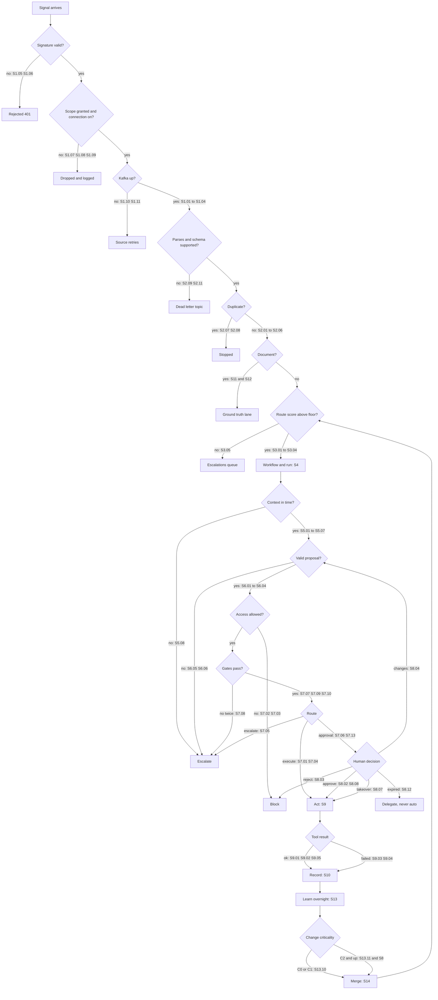

# Company Brain BDD Scenarios

This document lists everything the Company Brain can do. Each row is one use case, written as a BDD scenario. Together they cover the happy path and the unhappy path of every decision the system makes. So you can read it top to bottom and see the full capability of the application.

The scenarios come first, before more code. That way we can agree on what must happen. Then each stage is built and tested against its own scenarios.

## How to read a table

Every table has the same five columns. The first three tell you who does what. The last two tell you which path it is and exactly how it should behave.

| Column | Meaning |
|---|---|
| ID | A short code. It matches the tag on the scenario in the feature file. |
| Actor | Who acts. It can be a person with their tier, or a pipeline service. |
| Action | What happens, in a few words. |
| Path | Happy means things go as planned. Unhappy means a check fails, something breaks or someone is refused. |
| BDD | The full scenario in Given, When, Then form. |

The BDD keywords read like a short story. Given sets the scene. When is the action. Then is what must be true after. And adds one more line to the step above it.

Some rows say "(proposed)". The design docs do not define that behaviour yet. So I wrote the safest choice, and it needs your yes before we build it. They are all listed at the end.

## Where the files live

The feature files sit next to the code they test. Pipeline scenarios belong to the backend. Console scenarios belong to the frontend.

| Part | Folder | Files |
|---|---|---|
| Data pipeline | `backend/tests/features/pipeline/` | One file per stage, S1 to S15, plus the end to end lanes |
| Console and Studio | `frontend/tests/features/console/` | One file per area of the console |

This document is built from those files. So when a scenario changes, change the feature file first. Then rebuild this document.

## Coverage at a glance

There are 290 scenarios in all. The table shows how they split by use case type.

| Part | Use case type | Happy | Unhappy | Total |
|---|---|---|---|---|
| Pipeline | S1 Capture | 4 | 9 | 13 |
| Pipeline | S2 Normalize and protect | 6 | 6 | 12 |
| Pipeline | S3 Route | 5 | 2 | 7 |
| Pipeline | S4 Orchestrate | 2 | 2 | 4 |
| Pipeline | S5 Retrieve | 5 | 4 | 9 |
| Pipeline | S6 Reason | 3 | 3 | 6 |
| Pipeline | S7 Govern | 5 | 8 | 13 |
| Pipeline | S8 Decide | 5 | 9 | 14 |
| Pipeline | S9 Act | 1 | 5 | 6 |
| Pipeline | S10 Record | 4 | 3 | 7 |
| Pipeline | S11 Ingest knowledge | 4 | 3 | 7 |
| Pipeline | S12 Librarian | 3 | 4 | 7 |
| Pipeline | S13 Learn | 9 | 5 | 14 |
| Pipeline | S14 Version and release | 2 | 5 | 7 |
| Pipeline | S15 Readiness | 6 | 5 | 11 |
| Pipeline | End to end lanes | 4 | 2 | 6 |
| Console | Shell and navigation | 9 | 4 | 13 |
| Console | Ask the Brain | 4 | 6 | 10 |
| Console | Setup and connectors | 10 | 2 | 12 |
| Console | L1 Command | 8 | 1 | 9 |
| Console | L1 Approvals | 5 | 9 | 14 |
| Console | L1 Evidence requests | 4 | 2 | 6 |
| Console | L2 Knowledge | 9 | 1 | 10 |
| Console | L2 Security and access | 5 | 1 | 6 |
| Console | L2 Graph and versioning | 5 | 3 | 8 |
| Console | L2 Policies, skills and agents | 5 | 4 | 9 |
| Console | L2 Loops and readiness | 4 | 6 | 10 |
| Console | L3 Operations floor | 9 | 6 | 15 |
| Console | Workflow Studio | 13 | 8 | 21 |
| Console | Research Console | 2 | 2 | 4 |
| **All** | | **160** | **130** | **290** |

## The main decision tree

A signal enters at the top and a governed outcome leaves at the bottom. Each diamond is a decision. Each label on a branch names the scenarios that test it. So every branch of the tree has at least one scenario.

The learning lane closes the loop. A merge releases a new version, and the resolver uses it for the next signal. The readiness lane feeds the same tree from the side. It creates tasks and evidence requests (S15).

## Part 1. Data pipeline

The pipeline has fifteen stages. Each stage has one job and one written contract with its neighbours. The scenarios below test each stage alone, and then the whole pipeline together.

### S1 Capture

A source system sends something new. The capture stage checks it first. Then it stores the raw body once and publishes a small pointer to Kafka. The raw body never travels on Kafka.

File: `backend/tests/features/pipeline/s01_capture.feature`

| ID | Actor | Action | Path | BDD |
|---|---|---|---|---|
| S1.01 | Connector service | A verified webhook is stored and published | Happy | **Given** tenant "Finebase Labs" granted the Gmail source with scope "support inbox" **When** Gmail pushes a new message with a valid signature **Then** the raw body is written to object storage under its SHA256 hash **And** one RawSignalEnvelope is published to "signals.raw" **And** the envelope holds the raw object URI and not the raw body |
| S1.02 | Connector service | A poll worker captures a daily Clarity export | Happy | **Given** the Clarity source is granted with a daily poll **When** the poll worker runs its daily request **Then** each new export row is stored once in object storage **And** one envelope per export is published to "signals.raw" with source type "clarity_export" **And** the poll cursor moves past the captured rows |
| S1.03 | DRI | A person uploads a document | Happy | **Given** the DRI has an open evidence request **When** the DRI uploads an invoice PDF **Then** the file is stored in object storage under its SHA256 hash **And** one envelope with source type "upload" is published to "signals.raw" |
| S1.04 | Connector service | The same body arriving twice is stored once | Happy | **Given** a raw body was already stored under its SHA256 hash **When** the same body arrives again with the same external ID **Then** object storage still holds one copy **And** no second envelope is published |
| S1.05 | Connector service | A webhook with a bad signature is rejected | Unhappy | **When** a webhook arrives with a signature that does not verify **Then** the capture service answers 401 **And** nothing is written to object storage **And** nothing is published to "signals.raw" |
| S1.06 | Connector service | Many bad signatures raise an alert | Unhappy | **When** 10 webhooks with bad signatures arrive within 5 minutes **Then** an alert is raised for that connector **And** every one of them is still rejected with 401 |
| S1.07 | Connector service | A signal from a scope the tenant never granted is dropped | Unhappy | **Given** the tenant did not grant the "finance inbox" scope **When** a message arrives from the finance inbox **Then** the signal is dropped before storage **And** the drop is logged with the connector and the missing scope |
| S1.08 | Connector service | A signal from a revoked grant is dropped | Unhappy | **Given** the finance inbox grant was revoked **When** a message arrives from the finance inbox **Then** the signal is dropped before storage **And** the drop is logged with the revoked grant ID |
| S1.09 | Connector service | A paused connection captures nothing | Unhappy | **Given** the Slack connection is switched off **When** a new Slack message is posted **Then** nothing is stored and nothing is published **And** the connection shows "Off" in the connectors list |
| S1.10 | Connector service | Kafka is down when a webhook arrives | Unhappy | **Given** Kafka is unavailable **When** a verified webhook arrives **Then** the capture service answers 503 so the source retries later **And** no envelope is lost once Kafka is back |
| S1.11 | Connector service | Kafka is down during a poll | Unhappy | **Given** Kafka is unavailable **When** the poll worker runs **Then** the local cursor does not move past unpublished rows **And** the next poll publishes the missed rows once Kafka is back |
| S1.12 | Connector service | A body larger than 25 MB goes to the upload path | Unhappy | **When** a signal arrives with a body larger than 25 MB **Then** it is not published as a normal envelope **And** it is handed to the upload path |
| S1.13 | Connector service | Only allowlisted headers are kept | Unhappy | **When** a webhook arrives with headers outside the allowlist **Then** the envelope keeps only allowlisted headers in "headers_subset" |

### S2 Normalize and protect

The normalizer turns every raw signal into one canonical Signal. It masks personal data on the way. It also stops duplicates.

File: `backend/tests/features/pipeline/s02_normalize.feature`

| ID | Actor | Action | Path | BDD |
|---|---|---|---|---|
| S2.01 | Normalizer | An inbound email becomes a canonical Signal | Happy | **Given** a RawSignalEnvelope for a customer email is on "signals.raw" **When** the normalizer reads it **Then** one Signal with kind "customer_message" and channel "email" is published to "signals.normalized" **And** the Signal carries tenant, cluster, actor, subject and time **And** it links back to the raw event ID |
| S2.02 | Normalizer with PII vault | Personal data is swapped for vault tokens | Happy | **Given** a customer email holds a name, an email address, a phone number, a NIC number and a card fragment **When** the normalizer masks it **Then** each of those values is replaced by a token that starts with "pii_tok_" **And** the vault holds the token to value map **And** the published Signal lists every token in "pii_tokens" |
| S2.03 | Normalizer | A message with no personal data has an empty token list | Happy | **Given** a billing webhook holds no personal data **When** the normalizer reads it **Then** the Signal is published with an empty "pii_tokens" list |
| S2.04 | Normalizer | A document signal also goes to knowledge ingest | Happy | **Given** an uploaded contract arrives on "signals.raw" **When** the normalizer reads it **Then** a Signal with kind "document_arrived" is published to "signals.normalized" **And** the ingest stage receives it as well as the resolver |
| S2.05 | Normalizer | Each attachment becomes its own document signal | Happy | **Given** a customer email has two PDF attachments **When** the normalizer reads it **Then** the email Signal lists both attachments **And** two document Signals are published, one per attachment |
| S2.06 | Normalizer | One customer's messages keep their order | Happy | **Given** customer "C1" sends three emails in a row **When** the normalizer publishes them **Then** all three use the same key on "signals.normalized" **And** consumers read them in the order they were sent |
| S2.07 | Normalizer | A duplicate signal stops here | Unhappy | **Given** a Signal with dedup key "K" was already published **When** another raw signal produces the same dedup key "K" **Then** nothing new is published **And** the duplicate is counted in Sensors health |
| S2.08 | Normalizer | The same event is delivered twice by Kafka | Unhappy | **Given** an envelope with event ID "E" was already processed **When** Kafka delivers event "E" again **Then** the normalizer skips it **And** exactly one Signal exists for event "E" |
| S2.09 | Normalizer | A raw body that cannot be parsed goes to the dead letter topic | Unhappy | **Given** a raw body is broken JSON **When** the normalizer reads it **Then** the envelope goes to "signals.raw.dlq" with the parse error **And** Sensors health shows the failure for that connector |
| S2.10 | Normalizer | An older schema version is still accepted | Unhappy | **Given** the current envelope schema version is N **When** an envelope with schema version N minus 1 arrives **Then** the normalizer reads it as usual |
| S2.11 | Normalizer | A schema version two steps old is refused | Unhappy | **Given** the current envelope schema version is N **When** an envelope with schema version N minus 2 arrives **Then** it goes to "signals.raw.dlq" with reason "unsupported_schema_version" |
| S2.12 | Normalizer with PII vault | The vault is down so nothing leaves unmasked (proposed) | Unhappy | **Given** the PII vault is unreachable **When** a customer email with personal data is read **Then** no Signal is published **And** the envelope is retried later **And** no unmasked value appears on any topic |

### S3 Route

The resolver matches each Signal to an activity, a skill and an agent. It reads the resolver table from the production branch. When nothing fits, a person sees it.

File: `backend/tests/features/pipeline/s03_route.feature`

| ID | Actor | Action | Path | BDD |
|---|---|---|---|---|
| S3.01 | Resolver | A refund email routes to the refund skill | Happy | **Given** skill "refund_standard" version 4 is on main for the Refund Agent **And** a refund email Signal is on "signals.normalized" **When** the resolver scores it at 0.91 **Then** one TaskRequest is published to "tasks.created" **And** it pins skill "refund_standard" version 4 with its commit ID **And** it carries a base criticality, a due time and a priority |
| S3.02 | Resolver | A close tie is broken by the fast model | Happy | **Given** two resolver rules score within the tie margin for one Signal **When** the resolver asks Claude Haiku to break the tie **Then** one TaskRequest is published with the chosen rule ID **And** the trace records both scores and the tie break |
| S3.03 | Resolver | A task acts for a person | Happy | **Given** the Signal is a request a human sent through the console **When** the resolver creates the task **Then** "on_behalf_of" names that human **And** the agent can never do more than that human may do |
| S3.04 | Resolver | A release changes routing for the next signal | Happy | **Given** "graph.released" carries a new commit with skill "refund_late_annual" version 1 **When** the resolver reloads its table **Then** the next matching Signal pins "refund_late_annual" version 1 |
| S3.05 | Resolver | Nothing matches above the score floor | Unhappy | **Given** the score floor is 0.72 **When** the best rule scores 0.55 for a Signal **Then** the Signal goes to "tasks.unrouted" **And** the escalations queue shows it to a person **And** the nightly review counts it as a wrong route candidate |
| S3.06 | Resolver | A readiness gap dispatches an agent | Happy | **Given** a GapDetected event with action "dispatch_agent" is on "evidence.gaps" **When** the resolver reads it **Then** a TaskRequest is published for the Compliance Agent to fetch the missing item |
| S3.07 | Resolver | The resolver missed a release | Unhappy | **Given** the resolver did not receive the last release event **When** the next Signal arrives **Then** the commit check sees that main moved **And** the resolver reloads before it routes |

### S4 Orchestrate

Each task runs as one durable workflow. The workflow survives restarts and long waits. A retry can never start the same task twice.

File: `backend/tests/features/pipeline/s04_orchestrate.feature`

| ID | Actor | Action | Path | BDD |
|---|---|---|---|---|
| S4.01 | Orchestrator | A task starts one workflow and opens a run | Happy | **Given** a TaskRequest with task ID "T1" is on "tasks.created" **When** the orchestrator reads it **Then** one durable workflow starts with workflow ID "T1" **And** one Run row is created **And** the console receives a live "run started" event |
| S4.02 | Orchestrator | The same task is delivered twice | Unhappy | **Given** a workflow with ID "T1" is already running **When** "tasks.created" delivers task "T1" again **Then** no second workflow starts **And** one Run exists for "T1" |
| S4.03 | Orchestrator | A release in the middle of a run does not change the skill | Happy | **Given** run "R1" pinned skill "refund_standard" version 4 **When** version 5 is released while "R1" is still running **Then** "R1" finishes on version 4 |
| S4.04 | Orchestrator | A worker crashes in the middle of a run | Unhappy | **Given** run "R1" finished its retrieval step **When** the worker process stops **Then** a new worker resumes "R1" from its history **And** the retrieval step does not run again |

### S5 Retrieve

The agent asks for context. The context service returns only what the agent may see. Every allowed and denied item is logged.

File: `backend/tests/features/pipeline/s05_retrieve.feature`

| ID | Actor | Action | Path | BDD |
|---|---|---|---|---|
| S5.01 | Context service | Allowed facts come back with their source and valid time | Happy | **Given** the Refund Agent holds "internal" level **When** it asks "What is the refund window for annual plans?" **Then** the bundle holds the refund window fact with its document, page and span **And** each item shows valid from, valid to and recorded at **And** the answer comes back within 2 seconds |
| S5.02 | Context service | An agent acting for a person gets the smaller set of rights | Happy | **Given** the Care Agent holds "confidential" level **And** it acts for an operator who holds "internal" level **When** it asks for context **Then** only items at "internal" level or below come back |
| S5.03 | Context service | A question about the past reads facts as of that date | Happy | **Given** the refund window was 30 days until 31 October and 14 days after **When** the agent asks with "as_of_valid" set to 15 October **Then** the bundle holds the 30 day fact |
| S5.04 | Context service | What the brain believed then can differ from what was true | Happy | **Given** the 14 day window was recorded on 20 October with valid from 1 October **When** the agent asks with "as_of_valid" 10 October and "as_of_recorded" 15 October **Then** the bundle holds the 30 day fact the brain believed on 15 October |
| S5.05 | Context service | A replay reads from a sandbox branch | Happy | **Given** a sandbox branch changes the refund window **When** a replay asks for context on that branch **Then** the bundle holds the sandbox version of the fact |
| S5.06 | Context service | Restricted items are counted but never returned | Unhappy | **Given** three matching chunks are "restricted" and the agent holds "internal" **When** it asks for context **Then** those chunks are not in the bundle **And** "denied_count" is 3 with the deciding rule **And** three deny records are written to "access.decisions" |
| S5.07 | Context service | Retrieval times out once and then works | Unhappy | **Given** the first context query takes longer than 2 seconds **When** the agent retries once **And** the retry answers in time **Then** the run continues with the bundle |
| S5.08 | Context service | Retrieval times out twice | Unhappy | **Given** both context queries take longer than 2 seconds **When** the retry also times out **Then** the run escalates with reason "context_unavailable" |
| S5.09 | Access service | The access service is unreachable during retrieval | Unhappy | **Given** OPA does not answer **When** the context service checks an item **Then** the item is denied with reason "access_service_unavailable" **And** nothing unchecked is returned |

### S6 Reason

Claude plans the work and drafts a reply or an action. It cites every item it relies on. The action it proposes says exactly what it touches.

File: `backend/tests/features/pipeline/s06_reason.feature`

| ID | Actor | Action | Path | BDD |
|---|---|---|---|---|
| S6.01 | Agent runtime | The agent drafts a cited reply | Happy | **Given** the Care Agent has a context bundle about invoice export **When** it judges the customer question **Then** it proposes action "reply_customer" with the drafted text **And** the proposal cites at least one item from the bundle |
| S6.02 | Agent runtime | A refund proposal says what it touches | Happy | **Given** the Refund Agent decides a refund is fair **When** it proposes the action **Then** the action is "issue_refund" with payment ref, amount and reason code **And** the amount is stored in minor units with currency "LKR" **And** "touches" marks money as true |
| S6.03 | Agent runtime | The agent has no allowed facts to answer from | Happy | **Given** the context bundle holds nothing about the question **When** the agent judges it **Then** it proposes action "escalate" with reason "missing_knowledge" **And** it does not guess an answer |
| S6.04 | Agent runtime | Invalid tool arguments are fixed on retry | Unhappy | **Given** the first proposal has an amount written as a decimal number **When** the schema check fails **Then** the agent retries with the schema feedback **And** the second proposal passes the check |
| S6.05 | Agent runtime | Tool arguments stay invalid after two retries | Unhappy | **Given** every proposal fails the schema check **When** the second retry also fails **Then** the run escalates with reason "invalid_tool_arguments" |
| S6.06 | Agent runtime | The model API fails | Unhappy | **Given** the model API returns an error **When** the agent retries twice and both fail **Then** the run escalates with reason "model_unavailable" |

### S7 Govern

Every proposed action passes four checks before it can run. First the access check, then the policy rules, then the quality gates, then criticality. The result is one of four routes: execute, approval required, escalate or block.

File: `backend/tests/features/pipeline/s07_govern.feature`

| ID | Actor | Action | Path | BDD |
|---|---|---|---|---|
| S7.01 | Governance service | A routine cited reply is cleared to run | Happy | **Given** the Care Agent proposes a cited reply with no money and no personal data **When** governance checks it **Then** access is allowed and every policy passes **And** every quality gate passes **And** criticality is C0 and the route is "execute" |
| S7.02 | Access service | Access is denied at action time | Unhappy | **Given** the Care Agent does not hold capability "tool:issue_refund" **When** it proposes a refund **Then** OPA answers deny with the rule and a plain reason **And** the route is "block" **And** the decision is logged in "access.decisions" |
| S7.03 | Access service | The access service is unreachable at action time | Unhappy | **Given** OPA does not answer **When** an action is checked **Then** the decision is deny with reason "access_service_unavailable" **And** the route is "block" |
| S7.04 | Governance service | A refund inside policy and under the threshold | Happy | **Given** refund policy version 3 has a 30 day window and an auto threshold of LKR 50,000 **When** the Refund Agent proposes a refund of LKR 8,000 for a plan bought 12 days ago **Then** every policy passes **And** criticality is C2 from the activity default **And** the route follows the agent autonomy for C2 |
| S7.05 | Governance service | A refund outside the window with no skill for it escalates | Unhappy | **Given** skill "refund_standard" version 4 has no step for late refunds **When** the Refund Agent proposes a refund of LKR 85,000 for a plan bought 41 days ago **Then** the policy result fails with reasons "outside_refund_window" and "above_auto_threshold" **And** criticality is C3 **And** the route is "escalate" |
| S7.06 | Governance service | A refund outside the window with a skill for it asks the DRI | Unhappy | **Given** skill "refund_late_annual" version 1 is live **When** the Refund Agent proposes the same LKR 85,000 refund **Then** criticality is C3 **And** the route is "approval_required" with one L1 approver |
| S7.07 | Governance service | A quality gate fails once and then passes | Unhappy | **Given** the drafted reply promises a refund before approval **When** the tone gate fails **Then** the draft goes back to the agent once with the gate feedback **And** the second draft passes every gate |
| S7.08 | Governance service | A quality gate fails twice | Unhappy | **Given** both drafts fail the grounding gate **When** the second draft fails **Then** the route is "escalate" |
| S7.09 | Governance service | A reply would leak personal data | Unhappy | **Given** the draft holds a raw customer phone number **When** the personal data gate runs **Then** the gate fails **And** no reply is sent |
| S7.10 | Governance service | A factual claim has no citation | Unhappy | **Given** the draft states a price with no cited item **When** the citation gate runs **Then** the gate fails with detail "uncited claim" |
| S7.11 | Governance service | Touching personal data moves criticality up one level | Happy | **Given** an action starts at C2 **When** it touches personal data **Then** criticality is C3 **And** the reason "touches personal data" is recorded |
| S7.12 | Governance service | Spanning two clusters moves criticality up one level | Happy | **Given** an action starts at C1 **When** it touches the Finebase Platform and the Finance and Compliance clusters **Then** criticality is C2 |
| S7.13 | Governance service | A critical action needs two L1 approvers and a cooling period | Happy | **Given** an action deletes ground truth **When** governance checks it **Then** criticality is C4 **And** the route is "approval_required" with two L1 approvers **And** a cooling period in hours is set |

### S8 Decide

When a person must decide, the workflow waits. Each request has one DRI, a deadline and an expiry. Nothing is ever approved by silence.

File: `backend/tests/features/pipeline/s08_decide.feature`

| ID | Actor | Action | Path | BDD |
|---|---|---|---|---|
| S8.01 | Approval service | An approval request is created and the run waits | Happy | **Given** governance routed a C3 refund to "approval_required" **When** the approval service creates the request **Then** "approvals.requested" carries one request with a plain summary **And** it names exactly one DRI, a due time and an expiry **And** the workflow sleeps until a decision or the expiry |
| S8.02 | Head of Customer Success (L1) | The DRI approves and the action runs | Happy | **Given** a C3 refund approval waits for the DRI **When** the DRI approves it **Then** "approvals.decided" carries decision "approve" **And** the workflow wakes and the action runs |
| S8.03 | Head of Customer Success (L1) | The DRI rejects | Unhappy | **Given** a C3 refund approval waits for the DRI **When** the DRI rejects it with a comment **Then** the action never runs **And** the run closes with outcome "blocked" |
| S8.04 | Head of Customer Success (L1) | The DRI asks for changes | Unhappy | **Given** a C3 refund approval waits for the DRI **When** the DRI requests changes with a comment **Then** the action does not run **And** the agent receives the comment and drafts again |
| S8.05 | Head of Customer Success (L1) | The DRI delegates to an eligible person | Happy | **Given** a C3 approval waits for the DRI **When** the DRI delegates it to the founder **Then** the founder receives the request **And** the decision records who delegated to whom |
| S8.06 | Head of Customer Success (L1) | Delegating to someone below the required tier | Unhappy | **Given** a C3 approval needs an L1 approver **When** the DRI tries to delegate it to an L3 operator **Then** the delegation is refused with "Delegate must be L1" |
| S8.07 | Customer Care Operator (L3) | A person takes over and edits the action | Happy | **Given** a refund approval waits **When** the operator takes over and changes the amount to LKR 40,000 **Then** the decision carries the edited final arguments **And** the tool runs with LKR 40,000 |
| S8.08 | Founder (L1) | Two different L1 approvers clear a C4 request | Happy | **Given** a C4 request needs two L1 approvers **When** the head of customer success approves first **Then** the request still waits for one more approver **When** the founder approves second **Then** the request is approved |
| S8.09 | Head of Customer Success (L1) | The same person approves a C4 request twice | Unhappy | **Given** the head of customer success already approved a C4 request **When** the same person approves it again **Then** the second vote is refused **And** the request still needs a different L1 approver |
| S8.10 | AI Operations Lead (L2) | The drafter tries to approve their own change | Unhappy | **Given** the AI operations lead drafted a change **When** they try to approve it **Then** it is refused with "You drafted this change. Someone else must approve it." |
| S8.11 | Knowledge Steward (L2) | An L2 steward tries to approve a C3 request | Unhappy | **Given** a C3 request waits **When** the knowledge steward tries to approve it **Then** it is refused because L2 approves up to C2 only |
| S8.12 | Approval service | Nobody answers before the expiry | Unhappy | **Given** a C3 request reaches its expiry with no decision **When** the timer fires **Then** the decision becomes "expired" **And** the request escalates to the DRI's delegate **And** the action never runs on its own |
| S8.13 | Head of Customer Success (L1) | A decision arrives after the expiry | Unhappy | **Given** a request already expired **When** the DRI tries to approve it **Then** it is refused with "This approval expired. Ask the drafter to resubmit." |
| S8.14 | Founder (L1) | A decision arrives for a request already decided | Unhappy | **Given** a request was already rejected **When** the founder tries to approve it **Then** it is refused with "This approval is rejected" |

### S9 Act

The tool adapter calls the outside system. Every call carries an idempotency key. So a retry can never refund twice.

File: `backend/tests/features/pipeline/s09_act.feature`

| ID | Actor | Action | Path | BDD |
|---|---|---|---|---|
| S9.01 | Tool adapter | An approved refund is called once and recorded | Happy | **Given** a refund of LKR 85,000 is approved **When** the tool adapter calls the payment gateway **Then** the call carries idempotency key "{tenant}:{run_id}:{step_id}" **And** "actions.executed" records status "succeeded" with the gateway refund ID **And** the response summary holds no personal data |
| S9.02 | Tool adapter | A retryable failure succeeds on a later attempt | Unhappy | **Given** the gateway times out on the first two calls **When** the adapter retries with backoff **Then** the third call succeeds **And** all three calls carried the same idempotency key **And** the gateway holds exactly one refund |
| S9.03 | Tool adapter | Retries run out | Unhappy | **Given** the gateway keeps timing out **When** the sixth attempt also fails **Then** the action is recorded as "failed" **And** the run closes with outcome "failed" **And** the DRI is notified |
| S9.04 | Tool adapter | A failure that cannot be retried | Unhappy | **Given** the gateway answers "card account closed" **When** the adapter reads the error as not retryable **Then** the action is recorded as "failed" at once **And** the human is notified **And** the defined compensation step runs and is recorded as "compensated" |
| S9.05 | Tool adapter | The same action is sent twice | Unhappy | **Given** the refund call already succeeded **When** the workflow replays the same step **Then** the gateway sees the same idempotency key **And** it still holds exactly one refund |
| S9.06 | Tool adapter | Sandbox runs never reach real tools | Unhappy | **Given** a run on a sandbox branch proposes a refund **When** the adapter receives it **Then** no outside system is called **And** the result is recorded as a simulated call |

### S10 Record

The recorder closes every run. It fills templates, stores the trace and appends the audit. Then the live console updates for everyone allowed to see it.

File: `backend/tests/features/pipeline/s10_record.feature`

| ID | Actor | Action | Path | BDD |
|---|---|---|---|---|
| S10.01 | Template service | A template field is filled with its source | Happy | **Given** the refund succeeded with a gateway refund ID **When** the recorder fills the refund register **Then** a new row holds the value, the source item and a fresh until time |
| S10.02 | Recorder | A run closes with its full trace | Happy | **Given** run "R1" finished all its steps **When** the recorder closes it **Then** the full trace is stored in object storage **And** one RunRecord with outcome, cost and latency is published to "runs.completed" |
| S10.03 | Audit service | Every consequential step is appended to the audit chain | Happy | **Given** run "R1" executed a refund **When** the audit event is appended **Then** its "prev_hash" equals the hash of the event before it |
| S10.04 | SSE gateway | Live updates reach only allowed viewers with data masked | Happy | **Given** an approval was created for a refund **When** the gateway pushes "approval.created" **Then** every viewer allowed to see it receives the event **And** the event shows masked personal data only |
| S10.05 | SSE gateway | A viewer without permission does not receive the event | Unhappy | **Given** an L3 operator is not allowed to see finance approvals **When** a finance approval is created **Then** the operator's stream does not carry it |
| S10.06 | Recorder | The recorder is down for a while | Unhappy | **Given** the recorder stops for 10 minutes **When** it starts again **Then** it catches up from Kafka with no lost runs **And** the console shows "delayed" while it catches up |
| S10.07 | Audit service | Someone edits an audit event (proposed) | Unhappy | **Given** an audit event was changed after it was written **When** the chain is verified **Then** verification fails at that event **And** the break is shown in the audit trail |

### S11 Ingest knowledge

Documents become knowledge here. Each one is filed, parsed, chunked and embedded. Then candidate facts are pulled out with their exact evidence.

File: `backend/tests/features/pipeline/s11_ingest.feature`

| ID | Actor | Action | Path | BDD |
|---|---|---|---|---|
| S11.01 | Ingest service | A document is filed by the filing rules | Happy | **Given** a pricing PDF arrives as a document Signal **When** the filing rules run **Then** the document gets a cluster, a type, a sensitivity, a retention and ACL labels **And** "docs.filed" carries it |
| S11.02 | Ingest service | Text, tables and scanned pages are extracted | Happy | **Given** a filed invoice has a table and one scanned page **When** the text is extracted **Then** the table rows and the scanned text are both in the output **And** "docs.extracted" carries it |
| S11.03 | Ingest service | Chunks are embedded with their access labels | Happy | **Given** extracted text from a "confidential" contract **When** it is chunked and embedded **Then** every chunk carries the "confidential" label and a full text index |
| S11.04 | Ingest service | Candidate facts are extracted with exact evidence | Happy | **Given** the pricing PDF says "Refund window for annual plans is 14 days" **When** candidate facts are extracted **Then** a FactCandidate holds that statement, its subject, value and valid time **And** its evidence points to the document, page and span **And** it is published to "facts.candidates" |
| S11.05 | Ingest service | A candidate with low confidence | Unhappy | **Given** the extractor is not confident about a value **When** the candidate is published **Then** it is marked "unverified" **And** it goes to the librarian queue |
| S11.06 | Ingest service | A document cannot be parsed (proposed) | Unhappy | **Given** an uploaded file is corrupted **When** extraction fails **Then** the Library shows extraction status "failed" with the reason **And** no facts are drafted from it |
| S11.07 | Ingest service | No filing rule matches a document (proposed) | Unhappy | **Given** no filing rule fits a new document **When** it is filed **Then** it gets the "restricted" label by default **And** it appears in the librarian queue as an orphan document |

### S12 Librarian

The librarian compares each candidate with ground truth. It labels it new, duplicate, conflict, stale or unverified. For a conflict, it proposes one change that fixes everything that depends on the old fact.

File: `backend/tests/features/pipeline/s12_librarian.feature`

| ID | Actor | Action | Path | BDD |
|---|---|---|---|---|
| S12.01 | Librarian | A new fact is drafted for approval | Happy | **Given** no fact exists about the onboarding fee **When** a candidate states the onboarding fee **Then** it is labelled "new" **And** a draft commit adds the fact with its evidence **And** a C3 change request opens for the DRI |
| S12.02 | Librarian | A duplicate only adds evidence | Happy | **Given** the fact "refund window is 30 days" already exists **When** a candidate states the same value from another document **Then** it is labelled "duplicate" **And** the new evidence is linked to the existing fact **And** no change request opens |
| S12.03 | Librarian | A conflict bundles every dependent into one change | Unhappy | **Given** the fact "refund window is 30 days" is on main **When** a candidate states "refund window is 14 days from 1 November" **Then** it is labelled "conflict" **And** the librarian lists every skill, policy, template and web page that depends on the old fact **And** one draft commit proposes the winning source, the new validity and every dependent update **And** a C3 change request opens |
| S12.04 | Librarian | A stale fact is proposed for closing | Unhappy | **Given** a fact's valid time ended last month **When** the librarian reviews it **Then** it is labelled "stale" **And** a change request proposes closing its validity |
| S12.05 | Knowledge Steward (L2) | An unverified claim waits for a person | Unhappy | **Given** a candidate is marked "unverified" **When** the knowledge steward opens the librarian queue **Then** the claim is listed with its evidence span **And** nothing is written to ground truth until it is verified |
| S12.06 | Version service | A merged fact never overwrites the old one | Happy | **Given** the refund window conflict change request is approved **When** it merges **Then** the 14 day fact is written to main **And** the 30 day fact gets its valid time closed **And** both versions remain readable |
| S12.07 | Head of Customer Success (L1) | A conflict proposal is rejected | Unhappy | **Given** the refund window conflict change request waits for the DRI **When** the DRI rejects it **Then** ground truth stays at 30 days **And** the conflict stays open in the librarian queue |

### S13 Learn

Every night the Quality Supervisor reviews yesterday's runs. It classifies each failure and drafts fixes. A person can also press Skillify to turn a case they handled into a draft skill.

File: `backend/tests/features/pipeline/s13_learn.feature`

| ID | Actor | Action | Path | BDD |
|---|---|---|---|---|
| S13.01 | Quality Supervisor (L2) | The nightly review classifies failures | Happy | **Given** yesterday had runs that escalated, failed or were denied **When** the nightly review starts at 02:00 Asia/Colombo **Then** each failure gets one class **And** the classes are wrong route, missing knowledge, stale policy, tool error, quality gate failure or access gap |
| S13.02 | Metrics service | Skill health and policy drift are computed | Happy | **Given** yesterday's refund runs **When** health is computed **Then** each skill shows task success, pass^k and conformance to observed runs **And** each policy shows its five freshness signals |
| S13.03 | Quality Supervisor (L2) | A drifting policy gets an invalidation proposal | Unhappy | **Given** observed refunds match the refund policy at 62 percent **When** the drift signal fires **Then** an invalidation proposal is drafted **And** nothing is invalidated without approval at its criticality |
| S13.04 | Quality Supervisor (L2) | A fix is drafted on a sandbox branch | Happy | **Given** a resolver synonym is missing for "money back" **When** the supervisor drafts a fix **Then** a commit lands on a new sandbox branch **And** a change request opens from that branch to main |
| S13.05 | Customer Care Operator (L3) | Skillify turns a handled case into a draft skill | Happy | **Given** the operator took over and closed a late refund conversation **When** the operator presses Skillify **Then** a sandbox branch holds draft skill "refund_late_annual" version 1 **And** a C3 change request opens for the DRI |
| S13.06 | Customer Care Operator (L3) | Skillify on a case no person handled | Unhappy | **Given** the agent handled the conversation alone **When** the operator presses Skillify **Then** it is refused with "Skillify needs a case a person handled. Take over first." |
| S13.07 | Customer Care Operator (L3) | Skillify pressed twice on the same case | Unhappy | **Given** the conversation was already skillified **When** the operator presses Skillify again **Then** the same change request is returned **And** no second branch is created |
| S13.08 | Eval runner | Sandbox tests and a replay run before any approval | Happy | **Given** a change request for a new skill is in draft **When** its checks run **Then** the eval suite and trigger evals run in the sandbox **And** a replay shows how many recent runs get a different decision **And** the plain diff, tests and impact preview are attached |
| S13.09 | Eval runner | Sandbox tests fail (proposed) | Unhappy | **Given** a draft skill fails 3 of its 18 eval cases **When** the checks finish **Then** the change request stays in "testing" **And** no approval request is created |
| S13.10 | Approval service | A C0 or C1 change merges by itself | Happy | **Given** a C1 resolver synonym fix passed its tests **When** its checks finish **Then** it merges automatically **And** the merge is logged and listed in the morning digest |
| S13.11 | Approval service | A C2 or higher change waits for its approver | Happy | **Given** a C2 skill step edit passed its tests **When** its checks finish **Then** it waits for an L2 steward |
| S13.12 | Orchestrator | A shadow run tests a candidate on live traffic | Happy | **Given** a candidate skill is on staging **When** live refund signals arrive **Then** the candidate runs beside production **And** it never calls an outside tool **And** its decisions are compared with production |
| S13.13 | Digest job | The morning digest is built | Happy | **Given** the nightly review finished **When** the digest is built **Then** it lists runs, failures, fixes applied and changes waiting |
| S13.14 | Digest job | A quiet night (proposed) | Unhappy | **Given** yesterday had no failures **When** the digest is built **Then** it says nothing needs a decision |

### S14 Version and release

The graph works like git. Main is Production, and main only moves by a merge. Every merge is announced so the rest of the pipeline reloads.

File: `backend/tests/features/pipeline/s14_version_release.feature`

| ID | Actor | Action | Path | BDD |
|---|---|---|---|---|
| S14.01 | Version service | A merge releases a new version | Happy | **Given** an approved change request adds skill "refund_late_annual" version 1 **When** it merges **Then** main points to a new commit with two parents and a release tag **And** "graph.released" carries the commit with the skill in its changed nodes **And** caches are cleared, the resolver reloads and the changed nodes are embedded again |
| S14.02 | Version service | Two branches changed the same node | Unhappy | **Given** another change to the refund policy merged after this branch was made **When** this change request tries to merge **Then** it is marked "conflict" **And** the conflict view shows both sides with their evidence |
| S14.03 | Version service | A C4 change merges before its cooling period ends | Unhappy | **Given** a C4 change is approved with a 24 hour cooling period **When** a merge is tried after 2 hours **Then** it is refused with "Cooling period has not ended" |
| S14.04 | Head of Customer Success (L1) | An approval comes before tests and replay | Unhappy | **Given** a change request has no tests and no impact preview **When** the DRI tries to approve it **Then** it is refused with "Nothing goes live blind: run sandbox tests and the replay first." |
| S14.05 | AI Operations Lead (L2) | A rollback shows what reverts and then reverts it | Happy | **Given** main has three commits after commit "M1" **When** the lead chooses roll back to "M1" **Then** the preview lists the three commits that will revert **When** the lead confirms **Then** a new rollback commit lands on main **And** skills added after "M1" are deprecated and removed from the resolver |
| S14.06 | Customer Care Operator (L3) | An L3 operator tries to roll back | Unhappy | **When** the operator tries to roll back main **Then** it is refused with "Rollback needs L2 or L1" |
| S14.07 | AI Operations Lead (L2) | A direct edit to main is refused | Unhappy | **When** anyone tries to change a node on main without a change request **Then** the edit is refused **And** it is saved as a draft on a sandbox branch instead |

### S15 Readiness

Each hour the brain compares the evidence it needs with what it has. It notices gaps early. Then it fetches what is missing or asks the right person. People still file.

File: `backend/tests/features/pipeline/s15_readiness.feature`

| ID | Actor | Action | Path | BDD |
|---|---|---|---|---|
| S15.01 | Readiness scheduler | The hourly tick finds a gap | Happy | **Given** the September VAT return needs input invoices that do not exist yet **When** the hourly readiness tick runs **Then** a GapDetected event with its due date is published to "evidence.gaps" |
| S15.02 | Readiness scheduler | A gap far from its deadline dispatches an agent | Happy | **Given** a gap is more than 21 days before its deadline **When** the action is chosen **Then** the action is "dispatch_agent" **And** no person is asked yet |
| S15.03 | Readiness scheduler | A gap close to its deadline asks the DRI | Happy | **Given** a gap is within 21 days of its deadline **When** the action is chosen **Then** the action is "request_dri" **And** the finance director receives an evidence request |
| S15.04 | Readiness scheduler | A gap that needs a new source asks for a grant | Happy | **Given** the input invoices live only in the finance inbox **When** the action is chosen **Then** the action is "request_grant" **And** the request shows the source, scope, retention, agents and how to revoke |
| S15.05 | Readiness scheduler | A request is already open for the same gap | Unhappy | **Given** an evidence request for the input invoices is still open **When** the tick runs again **Then** no second request is created |
| S15.06 | Approval service | Nobody answers an evidence request | Unhappy | **Given** an evidence request is unanswered **When** the deadline comes within 21, 14, 7 and then 2 days **Then** the request escalates at each of those points |
| S15.07 | Finance Director (L1) | All evidence arrives and readiness turns green | Happy | **Given** the VAT return lacks the invoices and the bank statement **When** the finance director uploads both **Then** each item becomes a fact with provenance **And** readiness turns green **And** the record says a human still files |
| S15.08 | Finance Director (L1) | Only part of the evidence arrives | Unhappy | **Given** the VAT return lacks two items **When** only the bank statement is uploaded **Then** readiness stays amber **And** the invoices request stays open |
| S15.09 | Founder (L1) | An approved grant lets the agent fetch the evidence | Happy | **Given** a finance inbox grant is C4 and waits for two L1 approvers **When** the second L1 approves it **Then** the Compliance Agent gains "finance:read" **And** the finance inbox sensor starts reading **And** the open evidence request is fulfilled from that source |
| S15.10 | Security Officer (L2) | A grant is revoked | Unhappy | **Given** the finance inbox grant is active **When** it is revoked **Then** the Compliance Agent loses "finance:read" **And** the finance inbox sensor stops |
| S15.11 | Readiness scheduler | A grant reaches the end of its retention (proposed) | Unhappy | **Given** a grant has a 90 day retention **When** 90 days pass **Then** access ends by itself **And** the DRI is told |

### End to end lanes

These scenarios run the whole pipeline. Every check looks at the system from outside. That means the outside sandboxes, the public API, the SSE stream and the Kafka topics.

File: `backend/tests/features/pipeline/e2e_lanes.feature`

Every scenario here starts from this setup. Given tenant "Finebase Labs" with currency LKR and timezone Asia/Colombo And the clock is frozen for the test

| ID | Actor | Action | Path | BDD |
|---|---|---|---|---|
| E2E.01 | Customer | A routine chat question is answered in under 10 seconds | Happy | **Given** the Care Agent is autonomous for product questions **When** a customer asks on chat how to export invoices **Then** the chat receives one cited reply within 10 seconds **And** one run closes with outcome "resolved" and no human touch **And** one trace ID links the webhook, every step and the console event |
| E2E.02 | Customer, operator and DRI | A late refund becomes a governed skill | Happy | **Given** policy "refund_policy" version 3 on main has a 30 day window and an auto threshold of LKR 50,000 **And** skill "refund_standard" version 4 is live for the Refund Agent **And** customer "C1" bought an annual plan for LKR 85,000 41 days ago **And** the head of customer success is the L1 DRI for refunds **When** customer "C1" emails the support inbox asking for a full refund **Then** the thread gets one acknowledgement within 10 seconds with no refund promise **And** the escalations queue lists "C1" with reasons "outside_refund_window" and "above_auto_threshold" **And** the payment sandbox has received no refund call **When** the L3 operator takes over and proposes a full refund of LKR 85,000 **Then** one C3 approval is assigned to the head of customer success **When** the head of customer success approves it **Then** the payment sandbox receives exactly one refund of LKR 85,000 with the run idempotency key **And** the customer gets one confirmation reply **And** the refund register has a new row whose source is the gateway refund ID **When** the operator presses Skillify on the closed conversation **Then** a sandbox branch holds draft skill "refund_late_annual" version 1 **And** its change request shows passing tests and a replay of at least 50 refund runs **And** the change request is C3 and waits for the head of customer success **When** the head of customer success approves and merges it **Then** "graph.released" carries the new commit with the new skill **When** customer "C2" with the same plan and age emails for a refund **Then** the run for "C2" uses "refund_late_annual" version 1 **And** an approval is created for the DRI without any escalation **And** the payment sandbox receives no refund call before that approval **And** the audit trail returns every step above in order with an unbroken hash chain **And** no message, response or event contains the raw name or email of "C1" or "C2" |
| E2E.03 | Knowledge Steward and DRI | A new pricing document updates ground truth | Happy | **Given** the fact "refund window is 30 days" is on main **When** a pricing PDF stating a 14 day window from 1 November is uploaded **Then** the Library lists the document with its sensitivity and retention **And** the librarian queue shows a conflict with every dependent listed **When** the knowledge steward asks the librarian to propose a resolution **And** the checks run **Then** one C3 change request waits for the DRI **When** the DRI approves it **Then** Ask the Brain answers 14 days for dates from 1 November **And** it answers 30 days for dates before that |
| E2E.04 | Finance Director and Founder | A tax deadline is made ready early | Happy | **Given** the September VAT return is due in 20 days and lacks input invoices **When** the readiness tick runs **Then** the finance director receives an evidence request with a suggested finance inbox grant **When** the finance director requests the grant **And** the founder and the head of customer success both approve it **Then** the Compliance Agent reads the invoices from the finance inbox **And** readiness for the VAT return turns green **And** no filing is made by the brain |
| E2E.05 | Customer | A refund the agent may not make is blocked end to end | Unhappy | **Given** the Care Agent does not hold capability "tool:issue_refund" **When** a customer asks the Care Agent for a refund on chat **Then** the run is blocked at the access check **And** the Security decision log shows the deny with its rule **And** the payment sandbox receives no call **And** the customer is told a person will follow up |
| E2E.06 | Approval service | An approval nobody answers never runs by itself | Unhappy | **Given** a C3 refund approval is created **When** its expiry passes with no decision **Then** the approval shows "expired" **And** the request moves to the DRI's delegate **And** the payment sandbox receives no call |

## Part 2. Console and Workflow Studio

The console is where people watch, decide and teach. L1 leads, L2 governs and L3 operates. Workflow Studio is open to all three. Each tier sees only what its role allows.

### Shell and navigation

Every screen shares one shell. It shows who you are, which environment you are in and where you can go. Higher tiers can look down, never up.

File: `frontend/tests/features/console/shell.feature`

| ID | Actor | Action | Path | BDD |
|---|---|---|---|---|
| SH.01 | Any user | Pick a persona and land on its home | Happy | **Given** I open Company Brain **When** I choose the head of customer success from the persona menu **Then** I land on L1 Command **And** the sidebar shows only L1 sections |
| SH.02 | Founder (L1) | A higher tier looks down | Happy | **Given** I am the founder **When** I open the L3 escalations queue **Then** I see the queue |
| SH.03 | Customer Care Operator (L3) | A lower tier tries to look up | Unhappy | **Given** I am the care operator **When** I open the L1 approvals address directly **Then** I see the permission denied state **And** no approval data is shown |
| SH.04 | Any user | The environment is always visible | Happy | **When** I open any screen on Production **Then** a band says Production **When** I open a sandbox branch **Then** the band names that sandbox branch |
| SH.05 | Any user | Jump anywhere with the command palette | Happy | **When** I press Cmd K and type "Refund Agent" **And** I pick the agent **Then** its profile opens |
| SH.06 | Any user | The palette finds nothing | Unhappy | **When** I press Cmd K and type "zzzz" **Then** the palette says there are no results |
| SH.07 | Any user | Read notifications | Happy | **Given** I have three unread notifications **When** I open one **Then** it is marked read and the count drops to two **When** I choose mark all read **Then** the count is zero |
| SH.08 | Founder (L1) | Switch tenant | Happy | **When** I switch the tenant to "Scale Demo" **Then** lists show hundreds of agents and stay responsive |
| SH.09 | Founder (L1) | Planned clusters show as placeholders | Happy | **When** I open the cluster switcher **Then** People, Product Engineering and Procurement show as planned |
| SH.10 | Any user | Switch between light and dark themes | Happy | **When** I choose the dark theme **Then** every screen uses the dark palette **And** my choice is kept next time |
| SH.11 | Any user | Demo data is labelled | Happy | **Given** the console runs on mock data **Then** a "Demo data" badge is visible |
| SH.12 | Any user | A list fails to load | Unhappy | **Given** the API returns an error for runs **When** I open Runs **Then** I see the error state with a retry button **When** I retry and the API answers **Then** the runs appear |
| SH.13 | Any user | A list is empty | Unhappy | **Given** there are no escalations **When** I open Escalations **Then** I see a short empty state |

### Ask the Brain

Anyone can ask the brain a question in plain words, by typing or by voice. Answers use only what the asker may see. Each one cites its source and when it is true.

File: `frontend/tests/features/console/ask_the_brain.feature`

| ID | Actor | Action | Path | BDD |
|---|---|---|---|---|
| AB.01 | Any user | Ask about the page I am on | Happy | **Given** I am on the refund window policy page **When** I type "Why is this policy drifting?" **Then** the brain asks whether I mean this page or the whole system **When** I choose this page **Then** I get a plain answer with numbered citations about that policy |
| AB.02 | Head of Customer Success (L1) | Ask about the whole system | Happy | **When** I ask "What is our refund window?" for the whole system **Then** I get a plain answer with numbered citations **And** each citation shows when the fact is true |
| AB.03 | Any user | A suggested question already knows its scope | Happy | **When** I tap a suggested question **Then** the brain answers without asking for the scope |
| AB.04 | Customer Care Operator (L3) | The answer needs facts I may not see | Unhappy | **When** I ask about the finance director's tax evidence **Then** the answer cites none of the restricted facts **And** it says some sources are locked for me |
| AB.05 | Any user | The brain does not know (proposed) | Unhappy | **When** I ask about something no fact covers **Then** the brain says it does not know **And** it does not make up an answer |
| AB.06 | Founder (L1) | Ask by voice | Happy | **Given** I am on the Ask page **When** I tap the orb and ask a question aloud **Then** my words appear as text **And** the answer is spoken back and shown with citations |
| AB.07 | Founder (L1) | The microphone is blocked | Unhappy | **Given** the browser blocks the microphone **When** I tap the orb **Then** I read "The microphone is blocked. Allow it in the browser, or type instead." |
| AB.08 | Founder (L1) | Nothing was heard | Unhappy | **When** I tap the orb and stay silent **Then** I read "I did not hear anything. Tap to try again." |
| AB.09 | Founder (L1) | The recording is too long | Unhappy | **When** I record more than about two minutes **Then** the recording is refused with "The recording is too long." |
| AB.10 | Founder (L1) | The voice service fails | Unhappy | **Given** the voice service is down **When** I ask aloud **Then** I see that voice failed **And** I can type the question instead |

### Setup and connectors

A short interview teaches the brain about a new business. It asks one question at a time. Every connection becomes a sensor, and what it reads flows into knowledge.

File: `frontend/tests/features/console/setup_and_connectors.feature`

| ID | Actor | Action | Path | BDD |
|---|---|---|---|---|
| ST.01 | Founder (L1) | Teach the brain about the business | Happy | **Given** I open Setup **When** I answer the business name, the website and what we do **And** I pick Gmail and Stripe as the tools we use **And** I connect each of them **And** I skip the MCP step **Then** I read that the brain is learning |
| ST.02 | Founder (L1) | Go back one question | Happy | **Given** I am on the tools question **When** I press Back **Then** I see my answer to what we do, ready to edit |
| ST.03 | Founder (L1) | Connect by signing in | Happy | **When** I connect Gmail by signing in and pick the support inbox **Then** the connection shows Connecting, then Reading, then In knowledge |
| ST.04 | Founder (L1) | Connect a database with a read only link | Happy | **When** I connect Postgres with a read only connection string **Then** the connection is saved and starts reading |
| ST.05 | Founder (L1) | Connect by upload, webhook or website | Happy | **When** I connect a tool by uploading export files **Then** the files are read into knowledge **When** I connect a tool by webhook **Then** I get a URL the tool can push events to **When** I connect our website **Then** the brain reads its public pages |
| ST.06 | Founder (L1) | Add an MCP server | Happy | **When** I paste the URL of an MCP server we already use **Then** the brain reads through that server |
| ST.07 | Founder (L1) | The tool is not in the catalog | Unhappy | **When** I type a tool name that is not listed **Then** it is saved as a request **And** it shows "Requested" in the connectors list |
| ST.08 | Founder (L1) | Connect the same thing twice | Unhappy | **Given** the support inbox is already connected **When** I connect the support inbox again **Then** the newer connection replaces the older one **And** the list shows one connection |
| ST.09 | Founder (L1) | Pause and resume a connection | Happy | **Given** Slack is connected **When** I switch it off **Then** it shows "Off" and nothing new is read **When** I switch it on **Then** it starts reading again |
| ST.10 | Founder (L1) | Disconnect a tool | Happy | **When** I disconnect Slack **Then** it leaves the connectors list |
| ST.11 | Any user | Use the brain from Claude | Happy | **Given** I open Use in Claude **When** I copy the server URL or the Claude Code command **Then** I can add the brain as an MCP server in Claude **And** Claude sees only what I may see |
| ST.12 | Founder (L1) | Choose what Claude may do | Happy | **Given** ask, search, read policies and see workflows are on **And** propose changes is off **When** I switch propose changes on **Then** changes Claude proposes go to approvals **And** nothing changes without an approval |

### L1 Command

L1 is for founders, directors and DRIs. They follow progress and risk. They also protect the legal entity and read the full audit.

File: `frontend/tests/features/console/l1_command.feature`

| ID | Actor | Action | Path | BDD |
|---|---|---|---|---|
| L1.01 | Founder (L1) | See the business at a glance | Happy | **When** I open the Brain overview **Then** each cluster shows health, autonomy, escalations, money at stake and cost **And** the legibility map shows which activities are not yet sensed, skilled, governed or reported |
| L1.02 | Founder (L1) | Open a cluster for detail | Happy | **When** I click the Finebase Platform cluster on the brain map **Then** its parts and workflows open as grouped tables |
| L1.03 | Founder (L1) | Read the morning digest | Happy | **When** I open To review **Then** I see what happened overnight **And** C0 and C1 fixes were applied and logged **And** bigger changes wait for a decision |
| L1.04 | Finance Director (L1) | Protect the legal entity | Happy | **When** I open Entity protection **Then** each obligation shows readiness, missing evidence, a countdown and its DRI **And** every date is labelled as sample data **And** the risk register lists each risk with its owner |
| L1.05 | Founder (L1) | Follow progress | Happy | **When** I open Progress **Then** I compare clusters, loops, experiments and template completion |
| L1.06 | Founder (L1) | Follow one story in the audit trail | Happy | **When** I open the audit trail for the customer 1042 refund story **Then** I see takeover, Skillify, tests, approval and merge in order **And** each line names who did it |
| L1.07 | Founder (L1) | Filter the audit trail | Happy | **When** I filter by actor, object, environment and criticality **Then** only matching events remain |
| L1.08 | Founder (L1) | The audit trail cannot be edited | Unhappy | **When** I open any audit event **Then** there is no edit or delete control |
| L1.09 | Founder (L1) | See the past with the as of view | Happy | **When** I move the as of date to last month **Then** the overview shows what was true then |

### L1 Approvals

Approval weight follows criticality. Routine work flows by itself. Consequential work stops for the right person, and nothing passes by silence.

File: `frontend/tests/features/console/l1_approvals.feature`

| ID | Actor | Action | Path | BDD |
|---|---|---|---|---|
| AP.01 | Head of Customer Success (L1) | The inbox is sorted by criticality and deadline | Happy | **When** I open my approvals **Then** the highest criticality and nearest deadline come first |
| AP.02 | Head of Customer Success (L1) | Approve a new skill and it goes live | Happy | **Given** the late refund skill passed tests and replay **When** I open it **Then** I see the plain diff, the replay, the tests and why it needs me **When** I approve **Then** it merges to Production **And** the Refund Agent uses it from now on |
| AP.03 | Head of Customer Success (L1) | Reject a change | Unhappy | **When** I reject a change request with a comment **Then** the change request shows "rejected" **And** main does not change |
| AP.04 | Head of Customer Success (L1) | Ask for changes | Unhappy | **When** I request changes with a comment **Then** the change request shows "changes requested" **And** the drafter can run the checks again after editing |
| AP.05 | Head of Customer Success (L1) | Delegate to another L1 | Happy | **When** I delegate an approval to the founder **Then** the founder gets a notification **And** the audit trail records the delegation |
| AP.06 | Head of Customer Success (L1) | Delegate to someone not allowed | Unhappy | **When** I try to delegate a C3 approval to the care operator **Then** I read "Delegate must be L1" |
| AP.07 | Founder (L1) | Two person rule for a critical change | Happy | **Given** a C4 capability grant proposed by the Security Sentinel **When** the head of customer success approves first **Then** it still needs a second, different L1 approver **When** I approve as the founder **Then** the grant merges and the Care Agent may refund up to LKR 10,000 |
| AP.08 | Head of Customer Success (L1) | Approve a critical change twice as the same person | Unhappy | **Given** I already approved a C4 request **When** I approve it again **Then** it is refused and still waits for another L1 |
| AP.09 | Founder (L1) | Approve my own draft | Unhappy | **Given** I drafted a change **When** I try to approve it **Then** I read "You drafted this change. Someone else must approve it." |
| AP.10 | AI Operations Lead (L2) | Approve above my ceiling | Unhappy | **When** I try to approve a C3 change request **Then** it is refused because L2 approves up to C2 |
| AP.11 | Head of Customer Success (L1) | Approve before tests and replay | Unhappy | **Given** a change request has no test results **When** I try to approve it **Then** I read "Nothing goes live blind: run sandbox tests and the replay first." |
| AP.12 | Head of Customer Success (L1) | Approve after it expired | Unhappy | **Given** an approval passed its deadline **When** I try to approve it **Then** I read "This approval expired. Ask the drafter to resubmit." |
| AP.13 | Founder (L1) | Decide on something already decided | Unhappy | **Given** an approval was rejected **When** I try to approve it **Then** I read that it is already rejected |
| AP.14 | Head of Customer Success (L1) | Approve from a phone | Happy | **Given** I open my approvals on a phone **Then** I can read the summary and approve without scrolling sideways |

### L1 Evidence requests

When the brain needs proof, it asks the DRI early. The DRI uploads files or grants a source. A grant always shows its scope, retention and revoke path first.

File: `frontend/tests/features/console/l1_evidence.feature`

| ID | Actor | Action | Path | BDD |
|---|---|---|---|---|
| EV.01 | Finance Director (L1) | Upload the requested evidence | Happy | **Given** the brain asked me for the September bank statement **When** I upload the file **Then** the request shows fulfilled **And** the obligation readiness updates |
| EV.02 | Finance Director (L1) | Upload to a request that is already fulfilled | Unhappy | **Given** the bank statement request is fulfilled **When** I try to upload again **Then** I read "Already fulfilled" |
| EV.03 | Finance Director (L1) | Read a grant before giving it | Happy | **Given** the brain suggests granting the finance inbox **When** I open the grant **Then** I see the scope, the 90 day retention, the agents that will use it and how to revoke |
| EV.04 | Finance Director (L1) | Request a grant | Happy | **When** I request the finance inbox grant **Then** a C4 approval waits for two L1 approvers **And** the evidence request shows it waits for the grant |
| EV.05 | Founder (L1) | A grant approval is rejected | Unhappy | **Given** the finance inbox grant waits for approval **When** I reject it **Then** the grant is not active **And** the evidence request stays open |
| EV.06 | Security Officer (L2) | Revoke a grant | Happy | **Given** the finance inbox grant is active **When** I revoke it **Then** the agent loses access and the sensor stops |

### L2 Knowledge

Stewards keep the brain worth asking. The vault holds verified facts with their proof. The Library, Resolver, Templates and Sensors show what sits behind every answer.

File: `frontend/tests/features/console/l2_knowledge.feature`

| ID | Actor | Action | Path | BDD |
|---|---|---|---|---|
| KN.01 | Knowledge Steward (L2) | Resolve a knowledge conflict | Happy | **Given** the librarian queue shows a refund window conflict **When** I ask the Librarian to propose a resolution **Then** one change request updates the policy and every dependent **When** I run the checks **Then** the change is C3 and waits for the L1 DRI |
| KN.02 | Knowledge Steward (L2) | Ask for a proposal twice | Unhappy | **Given** the Librarian already proposed a resolution for this item **When** I ask again **Then** I read "Already proposed" |
| KN.03 | Knowledge Steward (L2) | Read a fact with its proof | Happy | **When** I open a fact in the vault **Then** I see its evidence, valid time, recorded time, verifier and dependents |
| KN.04 | Knowledge Steward (L2) | Work the other queue items | Happy | **When** I filter the librarian queue to stale, duplicate, orphan or unverified items **Then** each item shows the proposed action |
| KN.05 | Knowledge Steward (L2) | Browse the Library | Happy | **When** I filter the Library by cluster, type and sensitivity **Then** each document shows extraction status, linked facts and retention |
| KN.06 | AI Operations Lead (L2) | Check routing in the Resolver | Happy | **When** I open the Resolver **Then** each event routes to an agent and a skill **And** trigger evals show the right skill fires |
| KN.07 | AI Operations Lead (L2) | Read the information templates | Happy | **When** I open Templates **Then** each template shows fields, source sensors, freshness rule, cadence, owner and agents |
| KN.08 | AI Operations Lead (L2) | Check sensor health | Happy | **When** I open Sensors **Then** each sensor shows health, subscribers, scopes, retention and a personal data flag |
| KN.09 | AI Operations Lead (L2) | Switch a sensor off | Happy | **When** I switch the review sites sensor off **Then** it shows "Off" **And** its subscribers stop receiving its events |
| KN.10 | AI Operations Lead (L2) | Filter overview pages by workflow | Happy | **When** I pick the refunds workflow on Policies, Skills or Sensors **Then** only items in that workflow remain |

### L2 Security and access

Security binds at the moment of action. Every allow and deny is logged with its rule. Personal data is masked by default, and every reveal is audited.

File: `frontend/tests/features/console/l2_security.feature`

| ID | Actor | Action | Path | BDD |
|---|---|---|---|---|
| SE.01 | Security Officer (L2) | Investigate a denied action | Happy | **When** I open Security and access **Then** the Care Agent's refund attempt shows deny by its rule **And** the log shows the principal, who it acted for, the rule and the latency |
| SE.02 | Security Officer (L2) | See what an agent can reach | Happy | **Given** I am on the knowledge graph **When** I choose view as Care Agent **Then** locked nodes and edges show the exact reason |
| SE.03 | Security Officer (L2) | See what an agent can reach for a person | Happy | **When** I choose view as Care Agent acting for the care operator **Then** only what both may reach stays unlocked |
| SE.04 | Security Officer (L2) | Reveal personal data with clearance | Happy | **Given** I hold confidential clearance **When** I reveal a masked customer email **Then** I see the real value **And** the reveal is written to the audit trail |
| SE.05 | Customer Care Operator (L3) | Reveal personal data without clearance | Unhappy | **Given** I hold internal clearance **When** I try to reveal a masked customer email **Then** I read "Revealing personal data needs confidential clearance" |
| SE.06 | Security Officer (L2) | A proposed grant waits for two L1 approvers | Happy | **When** I open the Security Sentinel's proposed refund grant **Then** it shows C4 and waits for two L1 approvals |

### L2 Graph and versioning

The graph holds skills, policies, security, sensors, templates, facts, agents and tools. It works like git. Nothing goes live blind, and any commit can be reverted.

File: `frontend/tests/features/console/l2_graph_versioning.feature`

| ID | Actor | Action | Path | BDD |
|---|---|---|---|---|
| GV.01 | AI Operations Lead (L2) | Explore the graph | Happy | **When** I open the graph **And** I switch between 3D, 2D and list views **And** I toggle node layers **Then** only the chosen node types show |
| GV.02 | AI Operations Lead (L2) | Test a draft skill before it goes live | Happy | **Given** I open "New skill: Late refund with DRI approval" in versions **When** I run the sandbox tests and the replay **Then** the replay shows 37 of the last 412 refund conversations would change **And** it is C3 and waits for the L1 DRI |
| GV.03 | AI Operations Lead (L2) | Run the checks again after approval was requested | Unhappy | **Given** the checks already ran and the request waits for approval **When** I run the checks again **Then** I read that the checks already ran |
| GV.04 | AI Operations Lead (L2) | Low criticality merges by itself after checks | Happy | **Given** a C1 FAQ wording change is in draft **When** I run the checks and they pass **Then** it merges to main automatically and is logged |
| GV.05 | AI Operations Lead (L2) | Roll back safely | Happy | **When** I choose roll back on an older commit on main **Then** I see every commit that would revert first **When** I confirm **Then** a rollback commit lands on main |
| GV.06 | Customer Care Operator (L3) | A rollback by L3 | Unhappy | **When** I try to roll back a commit **Then** I read "Rollback needs L2 or L1" |
| GV.07 | AI Operations Lead (L2) | A change request conflicts with a newer merge | Unhappy | **Given** another change to the same node merged after this branch was made **When** this change request is approved **Then** it shows "conflict" **And** the resolution view shows both sides with their evidence |
| GV.08 | AI Operations Lead (L2) | Read a node's history and tags | Happy | **When** I open the refund window node history **Then** I see every version with its commit, author and release tag |

### L2 Policies, skills and agents

Policies say what is allowed. Skills say how work is done. Agents move up in autonomy step by step. Main never changes directly. Every edit is a draft with its own change request.

File: `frontend/tests/features/console/l2_policies_skills_agents.feature`

| ID | Actor | Action | Path | BDD |
|---|---|---|---|---|
| PS.01 | Knowledge Steward (L2) | Travel in time through a policy | Happy | **Given** I open the refund window policy **When** I drag the as of slider back in time **Then** I see what was true then and what the brain believed then |
| PS.02 | Knowledge Steward (L2) | A policy is drifting | Unhappy | **Given** observed refunds no longer match the policy well **When** I open the refund window policy **Then** the freshness signals warn that it is drifting **And** an invalidation proposal waits for approval |
| PS.03 | Knowledge Steward (L2) | Change a policy from its page | Happy | **When** I press change in studio on the refund window policy **Then** Workflow Studio opens with that policy in focus |
| PS.04 | AI Operations Lead (L2) | Improve a skill safely | Happy | **Given** skills are sorted by conformance, weakest first **When** I edit step 2 of "Refund inside policy" **And** I save it as a draft **Then** a change request opens on a sandbox branch with a before and after diff |
| PS.05 | Customer Care Operator (L3) | An operator tries to author a skill | Unhappy | **When** I try to save a skill draft **Then** I read "Skills are authored at L2" |
| PS.06 | AI Operations Lead (L2) | Read a skill's demand | Happy | **When** I open a skill **Then** I see its steps, health and demand over time in read only form |
| PS.07 | AI Operations Lead (L2) | Promote an agent | Happy | **Given** the Billing Agent is supervised **When** I propose promoting it **Then** a change request to make it autonomous opens at the matrix criticality |
| PS.08 | AI Operations Lead (L2) | Promote an agent that is already autonomous | Unhappy | **Given** the Care Agent is autonomous **When** I try to promote it **Then** I read "Already autonomous" |
| PS.09 | Customer Care Operator (L3) | An operator tries to promote an agent | Unhappy | **When** I try to promote an agent **Then** I read "Promotions are proposed at L2" |

### L2 Loops and readiness

Every function is a loop of sensor, policy, tool, gate and learning. Experiments make loops better. The readiness scheduler finds missing evidence before deadlines.

File: `frontend/tests/features/console/l2_loops_readiness.feature`

| ID | Actor | Action | Path | BDD |
|---|---|---|---|---|
| LR.01 | AI Operations Lead (L2) | Run a website experiment to the end | Happy | **Given** Clarity found 312 rage clicks on the pricing toggle **When** I preview the fix on a sandbox branch **And** I start the A/B experiment **And** I conclude it **And** I keep and ship the winner **Then** the learning is recorded **And** the pricing change goes to L1 for approval |
| LR.02 | AI Operations Lead (L2) | Discard an experiment | Happy | **Given** an experiment was concluded **When** I discard it **Then** its sandbox branch is abandoned **And** the result is still kept as learning |
| LR.03 | AI Operations Lead (L2) | Start an experiment without a preview | Unhappy | **Given** an experiment is only proposed **When** I try to start it **Then** I read "Preview on a sandbox branch first" |
| LR.04 | AI Operations Lead (L2) | Preview an experiment twice | Unhappy | **Given** an experiment was already previewed **When** I preview it again **Then** I read "Already previewed" |
| LR.05 | AI Operations Lead (L2) | Conclude an experiment that is not running | Unhappy | **Given** an experiment is previewed but not started **When** I try to conclude it **Then** I read "Experiment is not running" |
| LR.06 | AI Operations Lead (L2) | Keep an experiment before it is concluded | Unhappy | **Given** an experiment is still running **When** I try to keep it **Then** I read "Conclude the experiment first" |
| LR.07 | AI Operations Lead (L2) | Discard an experiment with nothing to discard | Unhappy | **Given** an experiment is only proposed **When** I try to discard it **Then** I read "Nothing to discard" |
| LR.08 | Customer Care Operator (L3) | An operator tries to start an experiment | Unhappy | **When** I try to start a previewed experiment **Then** I read "Starting an experiment needs L2 or L1" |
| LR.09 | AI Operations Lead (L2) | Read a loop canvas | Happy | **When** I open the Website UX loop **Then** I see each stage with its live metric, run history, pending gates and experiments |
| LR.10 | Knowledge Steward (L2) | Find missing evidence before a deadline | Happy | **When** I run the readiness scheduler **Then** each gap shows one action: dispatch an agent, ask the DRI or request a source |

### L3 Operations floor

Agents do the work through APIs. Operators watch them live and step in when needed. Any case a person handles can become a skill.

File: `frontend/tests/features/console/l3_operations.feature`

| ID | Actor | Action | Path | BDD |
|---|---|---|---|---|
| L3.01 | Customer Care Operator (L3) | Watch the agent fleet | Happy | **When** I open Fleet **Then** every agent shows live status, queue, errors and cost **When** I switch to the grid **Then** a moving orb means an agent is working now |
| L3.02 | Customer Care Operator (L3) | Filter the fleet | Happy | **When** I filter the fleet by category and workflow **Then** only matching agents remain |
| L3.03 | Customer Care Operator (L3) | Read an agent profile | Happy | **When** I open the Refund Agent **Then** I see its sensors, skills, policies, capabilities, templates and autonomy **And** its running history shows each run with its actor and input |
| L3.04 | Customer Care Operator (L3) | Inspect a run step by step | Happy | **When** I filter Runs for customer 1042 and open the refund run **Then** each step is labelled model judgment or deterministic call **And** retrieved facts show their valid time **And** the escalation says exactly why the agent stopped |
| L3.05 | Customer Care Operator (L3) | Mark a run as wrong | Happy | **When** I mark a run wrong with a note **Then** the run and the agent show the mistake **And** the agent's DRI is notified |
| L3.06 | Customer Care Operator (L3) | Mark a run wrong with no note | Unhappy | **When** I mark a run wrong and leave the note empty **Then** I read "Say what went wrong" |
| L3.07 | Customer Care Operator (L3) | Mark a run wrong twice | Unhappy | **Given** the run is already marked wrong **When** I mark it wrong again **Then** I read "Already marked wrong" |
| L3.08 | Customer Care Operator (L3) | Find a conversation | Happy | **When** I search conversations for "refund" **Then** only matching conversations remain **When** I open the needs a human tab **Then** only conversations waiting for a person remain |
| L3.09 | Customer Care Operator (L3) | Take over, reply and hand back | Happy | **Given** a live conversation shows the agent's reasoning and proposed actions **When** I take over **And** I reply to the customer **Then** my reply appears in the transcript **When** I hand back **Then** the agent continues the conversation |
| L3.10 | Customer Care Operator (L3) | Reply without taking over | Unhappy | **When** I try to reply in a conversation the agent holds **Then** I read "Take over the conversation before replying" |
| L3.11 | Customer Care Operator (L3) | Send an empty reply | Unhappy | **Given** I took over a conversation **When** I send an empty message **Then** I read "Message is empty" |
| L3.12 | Customer Care Operator (L3) | Take over a closed conversation | Unhappy | **Given** the conversation is closed **When** I try to take over **Then** I read "Conversation is closed" |
| L3.13 | Customer Care Operator (L3) | Handle an escalation, then Skillify it | Happy | **Given** the escalations queue is sorted by risk and waiting time **When** I open the refund request from customer 1042 **And** I take over and reply myself **And** I close the conversation **And** I press Skillify **Then** my handling becomes a draft skill on a sandbox branch for L2 to test |
| L3.14 | Customer Care Operator (L3) | Skillify before taking over | Unhappy | **Given** the agent handled the conversation alone **When** I press Skillify **Then** I read "Skillify needs a case a person handled. Take over first." |
| L3.15 | Customer Care Operator (L3) | Check the template board | Happy | **When** I filter the template board to stale **Then** I see which fields are old, who filled them and from which source |

### Workflow Studio

Workflow Studio is where people shape how the brain works. A chat sits beside the parts of each workflow. Every edit goes to the Edit Review Agent first. Then it applies at once or goes for approval.

File: `frontend/tests/features/console/workflow_studio.feature`

| ID | Actor | Action | Path | BDD |
|---|---|---|---|---|
| WS.01 | Any user | Read why a workflow exists | Happy | **When** I pick the refunds workflow **Then** I see the problem, how it is handled today and its cases as BDD stories **And** each case shows which parts cover it |
| WS.02 | Founder (L1) | Describe a new problem in chat | Happy | **When** I describe a problem the brain does not handle yet **Then** the assistant drafts a story with its cases **And** I confirm the cases before anything is built |
| WS.03 | Founder (L1) | Ask for a change in plain words | Happy | **When** I ask the assistant to raise the refund auto threshold to LKR 60,000 **Then** it shows a proposal card with the before and after values **And** the Edit Review Agent gives a verdict, a criticality and what else is affected |
| WS.04 | Any user | The assistant is not sure what I mean | Unhappy | **When** I ask for a change that could fit two parts **Then** the assistant asks which part I mean |
| WS.05 | Founder (L1) | The change would change nothing | Unhappy | **When** I ask to set a value to what it already is **Then** I read "Nothing would change. Say what the new value should be." |
| WS.06 | Head of Customer Success (L1) | A low risk edit applies at once | Happy | **Given** the Edit Review Agent marks a description edit minimal and C0 **When** I confirm it **Then** it applies at once and is logged |
| WS.07 | Head of Customer Success (L1) | A C2 edit by the workflow owner applies at once | Happy | **Given** I own the refunds workflow **And** the review marks my edit moderate and C2 **When** I confirm it **Then** it applies at once because C2 is inside my ceiling |
| WS.08 | Founder (L1) | A C3 edit goes for approval | Happy | **Given** the review marks my policy edit C3 **When** I confirm it **Then** it opens a change request on a sandbox branch **And** the checks run and it waits for the DRI **And** it applies when it merges |
| WS.09 | AI Operations Lead (L2) | An L2 steward drafts and never applies | Happy | **When** I confirm any edit **Then** it is sent for approval at C2 or above **And** it never applies by my hand |
| WS.10 | Customer Care Operator (L3) | An L3 operator tries to apply an edit | Unhappy | **When** I try to confirm an edit **Then** I read "L3 can view workflows and suggest edits, but cannot change them." |
| WS.11 | Customer Care Operator (L3) | An L3 operator suggests an edit | Happy | **When** I send an edit as a suggestion **Then** the workflow DRI is notified with the review verdict **And** nothing changes until the DRI acts |
| WS.12 | Founder (L1) | A breaking edit sent without reading the review | Unhappy | **Given** the review marks my edit breaking **When** I send it without confirming the review **Then** I read "The Edit Review Agent marked this breaking. Read the review and confirm before sending it." |
| WS.13 | Founder (L1) | A breaking edit sent after reading the review | Happy | **Given** the review marks my edit breaking **When** I confirm the review and send it **Then** it goes for approval at C2 or above with the problems noted |
| WS.14 | Founder (L1) | Apply the suggested fixes first | Happy | **Given** the review lists a fix for a breaking problem **When** I apply the fix **Then** the review runs again without that problem |
| WS.15 | Founder (L1) | Delete a part others depend on | Unhappy | **When** I ask to delete a tool that an active skill uses **Then** the review marks it breaking **And** it names the skill that would point at nothing |
| WS.16 | Founder (L1) | Change a shared tool | Unhappy | **When** I edit a tool that other workflows use **Then** the review warns which other workflows change with it |
| WS.17 | Founder (L1) | Add a tool at the simplest level | Happy | **When** I ask for a new tool **Then** the assistant tries a ready made tool first **And** then a set up tool **And** custom code only when nothing simpler does the job |
| WS.18 | Founder (L1) | A custom code tool passes its sandbox test | Happy | **Given** my custom tool exports an async run function **When** the sandbox test runs **Then** it passes and the tool can be saved |
| WS.19 | Founder (L1) | A custom code tool fails its sandbox test | Unhappy | **When** the code is empty, has no run function, reaches outside the sandbox or has unbalanced braces **Then** the test fails with the reason **And** the tool cannot be saved |
| WS.20 | Any user | See and export the workflow diagram | Happy | **When** I switch to the diagram view **Then** the parts show as a connected diagram **When** I export it **Then** I get a draw.io file |
| WS.21 | Version service | A routed edit cannot apply when it merges | Unhappy | **Given** a studio change request waits for approval **And** its target was removed in the meantime **When** it merges **Then** the pending studio change shows "rejected" |

### Research Console

The research program has its own console. It only reads. It can be removed without touching the product.

File: `frontend/tests/features/console/research_console.feature`

| ID | Actor | Action | Path | BDD |
|---|---|---|---|---|
| RC.01 | Research Analyst (L2) | Monitor research metrics | Happy | **When** I open the Research Console **Then** metrics for skills, policies, security and integration are labelled SAMPLE |
| RC.02 | Research Analyst (L2) | Export sample values | Unhappy | **When** I try to export sample values as results **Then** the export is refused |
| RC.03 | Customer Care Operator (L3) | A product user opens the console | Unhappy | **When** I open the research address **Then** I see the permission denied state |
| RC.04 | Any user | The console is switched off | Happy | **Given** the research flag is off **When** I use the product **Then** no research page or link exists **And** every product screen still works |

## Proposed behaviour to confirm

These scenarios fill gaps in the design docs. Each one picks the safest behaviour I could find. Please confirm or change them before they are built.

| ID | Scenario | Use case type |
|---|---|---|
| S2.12 | The vault is down so nothing leaves unmasked | S2 Normalize and protect |
| S10.07 | Someone edits an audit event | S10 Record |
| S11.06 | A document cannot be parsed | S11 Ingest knowledge |
| S11.07 | No filing rule matches a document | S11 Ingest knowledge |
| S13.09 | Sandbox tests fail | S13 Learn |
| S13.14 | A quiet night | S13 Learn |
| S15.11 | A grant reaches the end of its retention | S15 Readiness |
| AB.05 | The brain does not know | Ask the Brain |

All tenant data in these scenarios is sample data. Dates, tax rules and amounts are examples. They are not legal or tax guidance.
